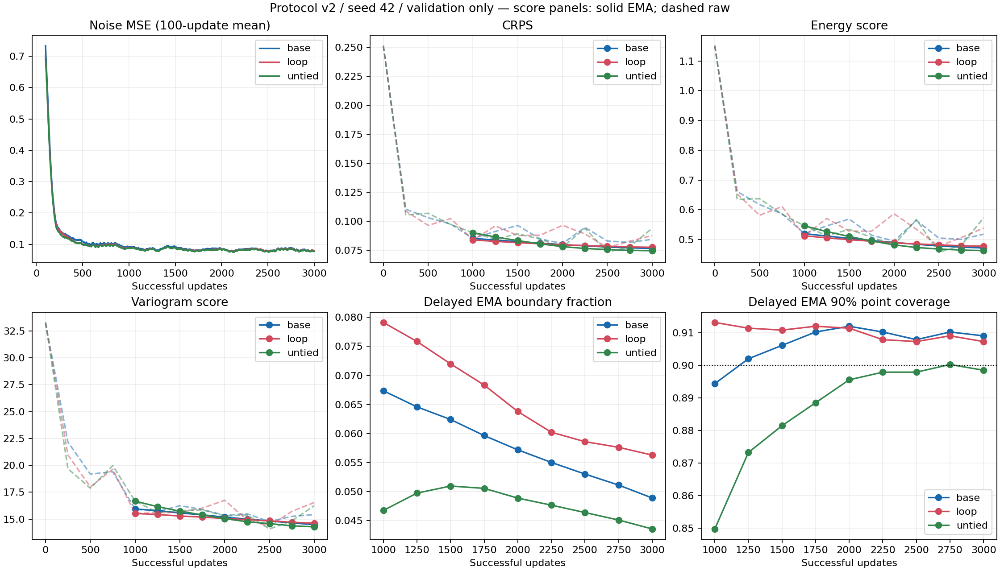

# 训练协议 v2：seed 42 架构对照

## 范围与运行证据

在评审基点 `b84c910` 上实现协议，训练代码冻结于 `f43ac14`。
BASE、LOOP、UNTIED 均在本机 WSL2 / RTX 2060 6GB 上从头运行，Python 3.10.20、
PyTorch 2.10.0+cu128、驱动 617.42。三个运行的源码哈希和数据文件哈希相同；
运行期间源码未修改。独立分支 `codex/training-v2-architecture-comparison`，没有改写 v1 结果。

遵循[预先冻结的 v2 协议](training_protocol_v2.md)：Zone 3、547/71/90 窗口，
FP32、有效批量 32、seed 42、每个模型 3,000 次成功更新，均无跳步，
各自保留的训练轨迹均有 96,000 次窗口暴露。第 1,000 步完整复制 EMA，从第 1,001 步按 0.999 平均。
全部 71 个有效验证日，每日 100 场景、DDIM 50 步、chunk 16。测试集未评分。

UNTIED 原进程在保存第 2,499 步后中断，原因未知，启动记录没有退出标记。
原目录保持不变，从正常 `checkpoint_last.pt` 在新目录追加 501 次更新；恢复核对模型、协议、
数据指纹及 best 身份。额外的第 2,499 步恢复诊断不参与选点或共同节点曲线。
中断时最多一个尚未落盘更新的计算量未计入保留轨迹；因此不能声称物理执行的样本暴露量
恰好等于 96,000，额外工作及中断开销不计入下表耗时。所有分段记录和哈希均保留。

## 实现验收

- CPU：73 项中 71 通过，2 项 CUDA 专用测试跳过。
- 实际 CUDA 环境：73/73 通过，包括延迟启动前后真实 AMP 溢出保护。
- 三模型真实入口、启动前/后续训、旧 v1 断点兼容、协议/模型身份拒绝均有回归检查。
- BASE/LOOP 的全部初始化张量哈希相同；UNTIED 公共组件和首个 Core 匹配，额外 Core
  使用独立初始化流和独立参数存储。三个终点的数据顺序、游标和训练加噪 RNG 状态相同。
- 三个启动检查点均为 update=1000、平均计数 0、raw 与 EMA 逐位相等；终点平均计数均为 2000。
- BASE 全程 3,000 步 loss、梯度范数、第 1,000/3,000 步 raw 权重与 v1 回放差为零。
  在线 EMA 与旧同 raw 轨迹下离线重构的最大参数差为
  `3.33786011e-06`，CRPS 差为
  `-1.29216171e-08`。这是浮点实现验收，不是第二份独立科学证据。
- 三模型固定终点及 best 的场景，均在 CPU 按样本身份独立重评；总分和逐窗口分数与保存结果完全一致。

验证命令：

```bash
python -m unittest discover -s tests -v
python -m py_compile train.py train_real.py
```

## 主表：固定第 3,000 步延迟 EMA

| 模型 | 更新数 | CRPS ↓ | ES ↓ | VS ↓ | 90% 点覆盖率 | 区间宽度 | 边界占比 |
|---|---:|---:|---:|---:|---:|---:|---:|
| BASE-2 | 3000 | 0.076405 | 0.471613 | 14.491014 | 90.90% | 0.4444 | 4.89% |
| LOOP-2×2 | 3000 | 0.077436 | 0.477581 | 14.625761 | 90.73% | 0.4480 | 5.63% |
| UNTIED-4 | 3000 | 0.074488 | 0.462814 | 14.283710 | 89.85% | 0.4270 | 4.35% |

## 辅表：共同九个节点上最低 EMA 验证 CRPS

候选为 1000、1250、…、3000；平手取更早节点。此表不替代主表。

| 模型 | 更新数 | CRPS ↓ | ES ↓ | VS ↓ | 90% 点覆盖率 | 区间宽度 | 边界占比 |
|---|---:|---:|---:|---:|---:|---:|---:|
| BASE-2 | 3000 | 0.076405 | 0.471613 | 14.491014 | 90.90% | 0.4444 | 4.89% |
| LOOP-2×2 | 3000 | 0.077436 | 0.477581 | 14.625761 | 90.73% | 0.4480 | 5.63% |
| UNTIED-4 | 3000 | 0.074488 | 0.462814 | 14.283710 | 89.85% | 0.4270 | 4.35% |

## 主表的逐日配对比较

负差值表示前者分数较低；日数只是描述统计，不是跨种子稳定性检验。

| 比较（前者减后者） | 平均 ΔCRPS | CRPS 更好的验证日 | 平均 ΔES | 平均 ΔVS |
|---|---:|---:|---:|---:|
| loop_vs_base | +0.001031 | 35/71 | +0.005967 | +0.134747 |
| untied_vs_base | -0.001917 | 44/71 | -0.008799 | -0.207304 |
| loop_vs_untied | +0.002948 | 27/71 | +0.014766 | +0.342051 |

在这套共同配方和 seed 42 下，LOOP 相对 BASE 的 CRPS 高约 1.35%，ES/VS 也较高，
CRPS 仅在 35/71 日更低；因此本轮没有观察到共享循环的质量收益。UNTIED 的三项评分最低，
CRPS 比 BASE 低约 2.51%，在 44/71 日更低。三者区间覆盖率均接近 90%，UNTIED 区间较窄。
这些差异是单次筛查结果，不构成跨种子稳定优势的证据。

## 实际成本

| 模型 | 参数量 | 独立 Core / 每次执行 | 更新耗时（秒） | 7,100 条轨迹采样（秒） |
|---|---:|---:|---:|---:|
| BASE-2 | 208,065 | 1 / 1 | 292.2 | 67.5 |
| LOOP-2×2 | 208,065 | 1 / 2 | 428.5 | 102.2 |
| UNTIED-4 | 365,697 | 2 / 2 | 419.9 | 104.8 |

更新耗时为同步计时的 `train_update` 累计，UNTIED 合并两段已落盘历史，排除验证、检查点 IO 和中断未记录开销；包含首次更新开销。
采样为终点同一 71×100 面板，排除评分，使用相同 chunk 和 DDIM 步数；是单次本机观测，
不是受控硬件基准或 FLOP 测量。相同更新数仅匹配样本暴露量。

## 曲线与解释边界



实线为延迟 EMA，虚线为 raw。CRPS、ES、VS、覆盖率和宽度应共同解释。
本轮是 seed 42 的机制筛查；不证明每个架构达到最优，也不支持“稳定优于”或跨时段泛化结论。
验证期排除了 21/92 个不完整日，结果仅代表 71 个有效日；本地数据来源和真实 NWP 可用时刻
尚未完成最终核验。没有增加模块、损失、采样器或额外 EMA 搜索。

## 产物与重现

小型产物位于 [pilots/architecture_v2_s42](pilots/architecture_v2_s42/)：配置、完整训练/验证历史、
两表 CSV、逐日配对 CSV、各节点指标、测试日志、源码/本地产物哈希与 BASE 回放核验。
运行目录为 `outputs/architecture_v2_s42_{base,loop,untied}/`，UNTIED 续训终点在
`outputs/architecture_v2_s42_untied_resumed/`；数据、检查点、场景等张量留在本地。
根目录指标对应固定终点，`selected/` 对应辅助 best。
汇总脚本 `docs/pilots/architecture_v2_s42/summarize.py` 从仓库根目录执行，
读取上述本地运行目录重新生成身份校验、评分及图表；需已完成三组运行。
