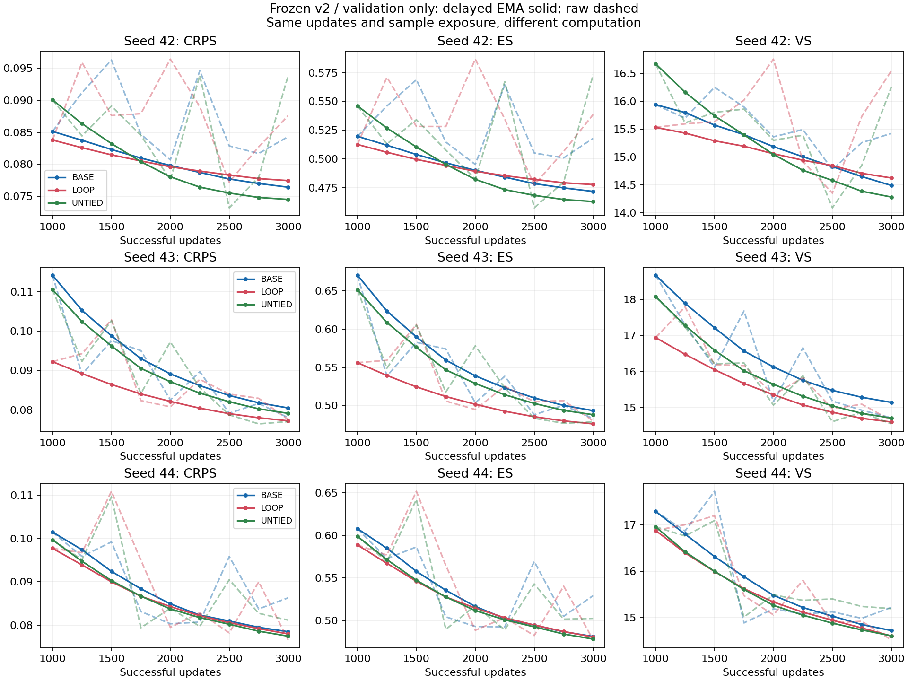

# v2 三种子架构对照：有限稳健性检查

已完成预定的 seed 43、44 六次训练，并与 seed 42 合并审计。**LOOP 的收益随种子变化：相对 BASE，三种子平均 CRPS 略低，但不是一致改善，且计算成本更高。当前不将两轮全共享方案提升为默认主方法。**这也不支持继续沿用“LOOP 始终更差”的单种子结论。

本轮结束于这三种子、九组模型，不追加循环轮数、训练长度、种子、EMA 搜索或采样随机性实验。测试集保持未评分。

## 冻结协议与证据范围

沿用 [v2 协议](training_protocol_v2.md) 与事先声明的 [多种子检查规则](architecture_v2_multiseed_protocol.md)：Zone 3，547/71/90 切分，FP32，有效批量 32；每组保留 3,000 次成功更新及 96,000 次窗口暴露。第 1,000 步完整复制 raw 到 EMA，从 1,001 步以 0.999 平均。全部 71 个完整验证日，100 条场景，50 步 DDIM，chunk 16，每 250 步验证；验证/RAND seed 固定 2026/2027。

参考提交 `72c97f8` 的七个训练、数据与评分源文件哈希均未改变。实际各次启动提交、命令、数据哈希与续训链路见 [evidence.json](pilots/architecture_v2_three_seeds/results/evidence.json)，数据指纹及完整设置见 [运行清单](../configs/architecture_v2_runs.json)。本轮实际在 RTX 2060 上执行 FP32 训练与采样；下述数字来自保存产物的独立 CPU 重评分。

## 主表：统一第 3,000 步延迟 EMA

CRPS、ES、VS 越低越好；覆盖率为 90% 中心区间的逐点覆盖率，必须与区间宽度共同阅读。

| Seed | 模型 | CRPS | ES | VS | 90% 覆盖率 | 宽度 |
| --- | --- | --- | --- | --- | --- | --- |
| 42 | BASE-2 | 0.076405 | 0.471613 | 14.491014 | 90.90% | 0.444377 |
| 42 | LOOP-2×2 | 0.077436 | 0.477581 | 14.625761 | 90.73% | 0.448025 |
| 42 | UNTIED-4 | 0.074488 | 0.462814 | 14.283710 | 89.85% | 0.426995 |
| 43 | BASE-2 | 0.080470 | 0.493062 | 15.146407 | 88.15% | 0.441585 |
| 43 | LOOP-2×2 | 0.077204 | 0.475705 | 14.602757 | 90.32% | 0.443775 |
| 43 | UNTIED-4 | 0.079105 | 0.487723 | 14.710684 | 90.32% | 0.445362 |
| 44 | BASE-2 | 0.078527 | 0.481245 | 14.716776 | 88.79% | 0.430827 |
| 44 | LOOP-2×2 | 0.078018 | 0.480519 | 14.597515 | 89.55% | 0.431590 |
| 44 | UNTIED-4 | 0.077501 | 0.478181 | 14.601441 | 89.85% | 0.433791 |

三种子均值 ± **样本标准差**（分母 `n−1=2`，不是置信区间）：

| 模型 | CRPS | ES | VS | 90% 覆盖率 (%) | 宽度 |
| --- | --- | --- | --- | --- | --- |
| BASE-2 | 0.078467 ± 0.002033 | 0.481974 ± 0.010743 | 14.7847 ± 0.3329 | 89.28 ± 1.44 | 0.438930 ± 0.007154 |
| LOOP-2×2 | 0.077553 ± 0.000419 | 0.477935 ± 0.002427 | 14.6087 ± 0.0150 | 90.20 ± 0.60 | 0.441130 ± 0.008531 |
| UNTIED-4 | 0.077032 ± 0.002344 | 0.476240 ± 0.012567 | 14.5319 ± 0.2218 | 90.00 ± 0.27 | 0.435382 ± 0.009287 |

RAND 在九组运行上的评分一致（CRPS 0.193308）。这里保留它作为共同参照，不据此宣称模型已正确利用 NWP。

## 配对差值：先在同一 seed 内相减

负的 CRPS/ES/VS 差值有利于左侧模型。下面每列对应一次训练种子的配对比较，不把 71 天合并成 213 次独立训练。

| 对比 | seed 42 ΔCRPS | seed 43 ΔCRPS | seed 44 ΔCRPS | 均值 | 样本标准差 |
| --- | --- | --- | --- | --- | --- |
| LOOP-2×2 − BASE-2 | +0.001031 | -0.003266 | -0.000509 | -0.000915 | 0.002177 |
| LOOP-2×2 − UNTIED-4 | +0.002948 | -0.001901 | +0.000516 | +0.000521 | 0.002425 |
| UNTIED-4 − BASE-2 | -0.001917 | -0.001364 | -0.001025 | -0.001436 | 0.000450 |

其他配对指标同样保留均值 ± 样本标准差。覆盖率差值采用**百分点**，其正负不直接代表优劣；宽度是归一化功率单位。

| 对比 | ΔES | ΔVS | Δ覆盖率 (百分点) | Δ宽度 |
| --- | --- | --- | --- | --- |
| LOOP-2×2 − BASE-2 | -0.004039 ± 0.012010 | -0.176055 ± 0.342746 | 0.9194 ± 1.1815 | 0.002200 ± 0.001443 |
| LOOP-2×2 − UNTIED-4 | 0.001695 ± 0.013404 | 0.076733 ± 0.235583 | 0.1956 ± 0.6108 | 0.005748 ± 0.013239 |
| UNTIED-4 − BASE-2 | -0.005734 ± 0.002888 | -0.252787 ± 0.164966 | 0.7238 ± 1.6393 | -0.003547 ± 0.011988 |

所有指标的逐种子差值见 [paired_seed_differences.csv](pilots/architecture_v2_three_seeds/results/paired_seed_differences.csv)，完整均值/标准差见 [summary.json](pilots/architecture_v2_three_seeds/results/summary.json)。逐日分数见 [scores_per_day.csv](pilots/architecture_v2_three_seeds/results/scores_per_day.csv)，仅用于诊断，不作为额外训练重复。

## 成本与边界诊断

下面是三个种子的实测均值 ± 样本标准差。训练秒数只计保留下来的优化器更新，排除验证、检查点 IO 和未记录的中断工作；采样秒数对应同一 7,100 条轨迹面板。它们不是 FLOP 数，也不是受控硬件基准。

| 模型 | 参数量 | 训练秒数 | 终点采样秒数 | 0/1 边界占比 (%) |
| --- | --- | --- | --- | --- |
| BASE-2 | 208,065 | 282.18 ± 11.93 | 67.60 ± 2.66 | 4.77 ± 0.23 |
| LOOP-2×2 | 208,065 | 421.56 ± 23.88 | 107.19 ± 4.79 | 5.68 ± 0.50 |
| UNTIED-4 | 365,697 | 438.54 ± 16.24 | 106.65 ± 3.27 | 4.82 ± 0.47 |

按上述均值之比，LOOP 的训练时间约为 BASE 的 **1.49 倍**，采样时间约为 **1.59 倍**；两者参数量相同。LOOP 相对 UNTIED 少约 43.1% 参数，但没有观测到采样时间优势；平均 CRPS 略高，不能称为已证实的“等质量压缩”。边界占比仅为分布诊断，不能单独判断预测是否更正确。

## 辅助 best 表：共同九个候选节点

候选节点仍为 1000、1250、…、3000，仅用延迟 EMA 验证 CRPS，平手取更早节点。九组运行均选中 3,000，因此本次辅助表的 CRPS、ES、VS、覆盖率、宽度与主表完全相同，不能将两张表当作两份独立证据。训练成本也相同；辅助产物另一次采样计时保留如下。

| 模型 | 42/43/44 选中更新 | best CRPS | best 采样秒数 |
| --- | --- | --- | --- |
| BASE-2 | 3000 / 3000 / 3000 | 0.078467 ± 0.002033 | 67.37 ± 3.84 |
| LOOP-2×2 | 3000 / 3000 / 3000 | 0.077553 ± 0.000419 | 107.05 ± 6.15 |
| UNTIED-4 | 3000 / 3000 / 3000 | 0.077032 ± 0.002344 | 106.80 ± 3.83 |

[完整主表和辅助表 CSV](pilots/architecture_v2_three_seeds/results/scores.csv) 分别保留 `primary` 与 `best`，没有看到结果后更换主表。

## 曲线与研究判断



实线为 EMA、虚线为 raw；图展示 EMA 启动后的共同节点，0–3000 的完整历史仍在归档 JSON。各行纵轴范围不同，跨种子的绝对比较应查看表格。相同更新次数不等于相同计算预算。

- LOOP 对 BASE：CRPS/ES/VS 在 seed 42 更差，在 43、44 更好。平均 CRPS 降约 1.17%，配对差值标准差大于均值绝对值。可以记录这一有限平均改善，但不能称为稳定收益；也不能将标准差本身当作显著性检验。
- LOOP 对 UNTIED：CRPS/ES 在 42、44 更差，在 43 更好；VS 在 43、44 更好。没有一致占优。LOOP 自身三个种子的分数标准差较小，也不足以由三点推断普遍更稳定。
- UNTIED 对 BASE：三个种子的 CRPS、ES、VS 均改善，平均 CRPS 降约 1.83%。这是当前共同配方下更一致的观察，但增加独立参数与深度的贡献尚未隔离，也不代表其已达到最优。
- 三组终点 EMA 曲线仍有下降趋势；本轮不是收敛证明，也不据此追加训练。

**本阶段决定：冻结当前两轮全共享方案的结果，不把它确立为默认主方法；保留为待解释的候选机制。**收益随种子变化，且相对 BASE 的额外成本明确。任何后续机制诊断应另立假设和预算，本轮没有启动。测试集继续封存。

结论仅适用于这套配方、三个训练种子与 71 个完整有效验证日。验证期丢弃 21/92 日，不能假定缺失随机；数据来源转换及实际 NWP 可用时间的既有证据缺口仍按 [数据协议](data_protocol.md) 保留。

## 运行完整性、验证与复现

seed 43 的三次运行均完整结束。seed 44 BASE 的原队列在第 2,749 步正常断点之后退出，主机进程检查确认已结束，日志未提供原因；原目录和旧 best 均保留，在新目录续训 251 步。恢复点 2749 的额外诊断不参加 best 选择。seed 42 UNTIED 的既有 2499＋501 记录保持不变。两条续训的原检查点、旧 best 和原 lineage 哈希均核对未改变。未保留的中断工作不计入训练耗时。

本轮实际检查：

- 18 组固定终点/best 保存场景独立 CPU 重评分，汇总值、逐窗口数组及其样本 ID/数据指纹均一致；全部为 validation。
- 9 组运行每组 3,000 次保留成功更新、96,000 次窗口暴露，损失及梯度范数有限；同种子共同初始张量、最终数据顺序和训练噪声 RNG 一致。
- EMA 启动步确为 raw 完整复制，终点平均次数均为 2,000；源码与数据哈希仍匹配冻结协议，RAND 结果在九组间一致。
- CPU 单元测试 **82 项：80 通过、2 项 CUDA 专用测试跳过**，其中新增汇总测试 9 项通过。Python 3.10.20，PyTorch 2.10.0+cu128；本轮没有重跑 CUDA AMP 单元测试。
- seed 42 的归档分数和训练成本逐项保持一致。六次新增训练队列状态为 complete，主机已无训练进程。

详见 [verification.json](pilots/architecture_v2_three_seeds/verification.json)、[CPU 测试日志](pilots/architecture_v2_three_seeds/tests_cpu.log)、[队列原始记录](pilots/architecture_v2_three_seeds/queue_records)。旧队列记录保持退出前状态；[resume1 队列记录](pilots/architecture_v2_three_seeds/queue_records/architecture_v2_seeds43_44_resume1_queue.json) 保存了续训队列的完成状态。

从仓库根目录，用新输出目录重建只读汇总（需要保留的本地张量）：

```bash
python summarize_runs.py --manifest configs/architecture_v2_runs.json \
  --output outputs/architecture_v2_three_seed_recheck
python docs/pilots/architecture_v2_three_seeds/plot_curves.py \
  --summary outputs/architecture_v2_three_seed_recheck \
  --output outputs/architecture_v2_three_seed_recheck.png
python -m unittest discover -s tests -v
```

报告层接受 seed 过滤和有序分段清单，拒绝不完整面板或覆盖源运行。原 seed-42 汇总脚本与历史记录未修改。归档仅含小型 JSON/CSV、曲线和验证记录；原始数据、场景张量和检查点继续留在 `outputs/`。
