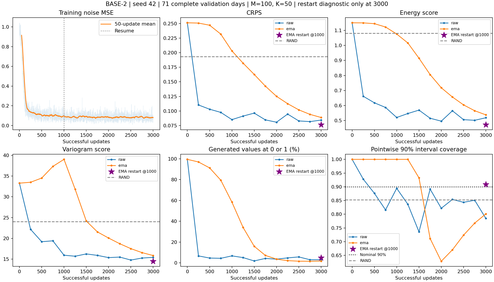

# BASE-2 续训至 3,000 步与 EMA 历史诊断

本轮从 [1,000 步 pilot](base_pilot_v1_s42.md) 的正常 `checkpoint_last.pt` 续训，追加 2,000 次成功更新。起点提交为 `dfa553e`；模型、扩散、损失、训练器和真实训练入口与 `1f2110a` 相同。本轮仅增加独立诊断脚本、测试及记录。旧 pilot 的产物、成绩和检查点选择规则保持不变。

## 预先固定的设置

Zone 3；数据指纹 `403ff1adc1df6b1bd6dd79b24f206f164daf3161f829bf7a232fddf90a9168a4`。继续采用 FP32、seed 42、微批次 4、累积 8、学习率 `1e-4`、EMA 衰减 `0.999`。验证仍为全部 71 个完整有效日，每条件 100 场景、50 步 DDIM、chunk size 16、噪声 seed 2026，每 250 步评价 raw 和原 EMA。检查点仍按最低原 EMA 验证 CRPS 选择，raw 与重构 EMA 不参与选择。测试集不评分。

```bash
conda activate code_rl_clean
python train_real.py \
  --data outputs/data_v1_20261014/data.pt --device cuda \
  --resume outputs/real_base_pilot_v1_s42/checkpoint_last.pt \
  --updates 2000 --output outputs/real_base_pilot_v1_s42_to3000
```

原目录中的 last/best 均保留。续训配置读取检查点而不是新的 CLI 默认值；启动后已核对完整验证面板和采样预算。总计 3,000 次更新相当于 96,000 次训练窗口暴露，不代表新增独立样本。

## 离线诊断方法与验证

固定只比较第 3,000 步的 raw、原 EMA 和假设在第 1,000 步由 raw 重新起算的 EMA。重构逐个 `named_parameter` 应用：

```text
restarted_ema_3000 = original_ema_3000
                    + 0.999**2000 * (raw_1000 - original_ema_1000)
```

`diagnose_ema.py` 不创建优化器、不更新 Trainer、不保存训练检查点、不更新 best。它在 CPU 上以 FP64 计算校正再转回原 FP32；buffers 直接沿用终点原 EMA，符合现有 Trainer 在成功更新后复制 buffers 的规则。该恒等式在精确算术下成立；由于原检查点已经经历 FP32 舍入，实际结果不能宣称与假想逐步 FP32 重启 EMA 逐位相同。没有实际保存该假想逐步序列，不能给出真实模型重构误差的实测上界。

新增测试以固定随机参数序列显式递推至 3,000 步，对照公式重构；FP64 最大误差实测 `3.05e-16`（容差 `1e-12`），FP32 最大误差 `3.13e-7`（容差 `1e-5`）。这些是测试序列的误差，不是实际模型误差上界。另检查原状态不被修改、整数／浮点 buffers 原样保留、无效张量、不同数据／配置、故障标记、错误更新数与不完整续训证据的拒绝路径。区间指数使用成功更新数，跳步不计入。

仅有相同模型与数据配置不足以证明续训来源。本次在启动前记录起点 last/best、运行配置、数据包和训练源码 SHA-256；运行成功退出后才记录终点哈希。诊断同时核对恢复路径、逐次成功更新历史及续训起点 raw／EMA 评价与旧运行精确一致。这是可信本机运行记录的核验，不是对每一步优化器转移的密码学证明；不能为无关检查点事后伪造这份记录。

```bash
python -m unittest discover -s tests -v
python diagnose_ema.py \
  --start outputs/real_base_pilot_v1_s42/checkpoint_last.pt \
  --end outputs/real_base_pilot_v1_s42_to3000/checkpoint_last.pt \
  --data outputs/data_v1_20261014/data.pt \
  --lineage outputs/real_base_pilot_v1_s42_to3000.lineage.json \
  --device cuda --output outputs/real_base_ema_history_diagnostic_3000
```

三种权重分别重新创建相同验证噪声生成器，复用已有采样与身份对齐评价入口。诊断输出与主运行分开，执行前后验证四个 last/best 文件哈希未改变。

## 本轮实测结果（2026-10-18）

RTX 2060（6 GB，驱动 617.42）、Python 3.10.20、PyTorch 2.10.0+cu128。追加 2,000 次成功更新、0 次跳步，总计 3,000 次成功更新。末 100 次更新的平均训练噪声 MSE 从 1,000 步时的 **0.091146** 降至 **0.079337**。

| 更新 | raw CRPS | 原 EMA CRPS | raw 90% 覆盖率 | 原 EMA 90% 覆盖率 |
| ---: | ---: | ---: | ---: | ---: |
| 1000 | 0.085117 | 0.203117 | 89.44% | 100.00% |
| 1250 | 0.091167 | 0.182120 | 83.63% | 100.00% |
| 1500 | 0.096277 | 0.162759 | 73.59% | 93.25% |
| 1750 | 0.084679 | 0.142616 | 89.14% | 71.13% |
| 2000 | 0.080673 | 0.125121 | 82.16% | 62.85% |
| 2250 | 0.094623 | 0.112482 | 85.39% | 67.02% |
| 2500 | 0.082850 | 0.101885 | 84.33% | 72.36% |
| 2750 | 0.081679 | 0.094142 | 85.09% | 76.76% |
| 3000 | 0.084304 | 0.088768 | 78.46% | 80.11% |

原规则仍选中 **第 3,000 步原 EMA**，其 CRPS 为 **0.088768**。离线重构成绩没有替换这份主运行结果。追加训练更新计时合计 184.67 秒，不含验证、评分和保存，不是完整运行耗时。



## 第 3,000 步固定终点对照

| 权重／参照 | CRPS | ES | VS | 90% 点覆盖率 | 90% 平均宽度 | 边界占比 |
| --- | ---: | ---: | ---: | ---: | ---: | ---: |
| RAND | 0.193308 | 1.081198 | 24.012031 | 85.21% | 0.8948 | — |
| raw @3000 | 0.084304 | 0.517861 | 15.424536 | 78.46% | 0.3680 | 3.03% |
| 原 EMA @3000 | 0.088768 | 0.537100 | 15.861715 | 80.11% | 0.4618 | 1.78% |
| 从 1000 步重新起算的 EMA @3000 | 0.076405 | 0.471613 | 14.491019 | 90.90% | 0.4444 | 4.89% |

重构 EMA 的 80% 点覆盖率为 **80.05%**，平均宽度 **0.3554**。相对原 EMA，逐日 CRPS、ES、VS 分别在 **58/71、59/71、52/71** 天更低；逐日 CRPS 差值中位数 **-0.01197**。这些是配对描述性结果，没有进行显著性检验。

## 可以得出的判断

1. **延长训练缓解了原 EMA 的滞后。** CRPS 从 0.20312 降至 0.08877，VS 从 39.01 降至 15.86；但原 EMA 的 90% 覆盖率仍只有 80.11%，不能仅凭评分追近 raw 就宣称校准完成。
2. **替换早期 EMA 历史带来了额外改善。** 相同后续参数序列、相同衰减率、相同终点和验证噪声下，重构副本在三项概率评分、覆盖率与多数验证日上改善，支持早期 EMA 历史在这条轨迹上有不利影响。该诊断替换的是整个前 1,000 步平均历史，不能单独归因于初始参数，也不能证明这是唯一原因。
3. **继续训练不是无条件改善。** raw @3000 相比 raw @1000 的 CRPS 仅下降约 0.00081，逐日 CRPS 在 36/71 天改善；90% 覆盖率从 89.44% 降到 78.46%。没有观察到持续单调恶化，但也不能把更多更新直接视为更好的概率分布。

建议将“第 1,000 步由 raw 初始化 EMA，之后衰减 0.999”作为下一版统一权重协议的候选，明确冻结后再用于 BASE／LOOP／UNTIED。此处没有证明重启点 1,000 最优，也没有修改现有训练器或正式选择规则；不再扩大 EMA 搜索范围。

## 验证与产物

- 全套 CPU 测试 **63 通过、1 项 CUDA 专用测试跳过**；新增 5 项诊断测试通过。未重新认证 AMP。
- 续训起点的 raw／EMA 报告与旧运行 @1000 精确一致；诊断的 raw／原 EMA 与主运行 @3000 的指标、身份及裁剪诊断精确一致。
- 三种诊断权重保存的场景／目标均经独立 CPU 重评，所有非诊断报告字段精确一致。验证结果见 [checks.json](pilots/base_v1_s42_to3000/checks.json)，全套测试原始日志见 [tests.log](pilots/base_v1_s42_to3000/tests.log)。
- 起点、终点及两份 best 文件在诊断前后 SHA-256 一致；模型、训练器、扩散、评分公式及旧 pilot 记录未修改。
- [运行配置](pilots/base_v1_s42_to3000/config.json)、[新增训练历史](pilots/base_v1_s42_to3000/training_history.json)、[完整 0–3000 验证曲线数值](pilots/base_v1_s42_to3000/combined_validation_history.json)。
- [主运行选中指标](pilots/base_v1_s42_to3000/metrics.json)、[离线诊断与来源记录](pilots/base_v1_s42_to3000/diagnostic/diagnostic.json)、[逐日配对差值](pilots/base_v1_s42_to3000/daily_comparisons.csv)、[汇总](pilots/base_v1_s42_to3000/summary.json)、[产物哈希](pilots/base_v1_s42_to3000/artifact_hashes.json)。
- 所有验证节点和三种诊断权重的完整 `metrics.json` 按原目录结构保存。大张量、目标和检查点仅在本机 `outputs/real_base_pilot_v1_s42_to3000/` 与 `outputs/real_base_ema_history_diagnostic_3000/`。

## 解释边界

这是单种子、单风场、单重启点的开发诊断，没有搜索多个重启点、衰减率或终点。参数平均不是预测平均；重构副本的改善只能支持这条参数轨迹上早期 EMA 历史的影响，不能证明唯一原因，也不能自动决定其他架构的配方。71 个验证日排除了 21/92 个缺失候选日；来源和 NWP 实际可用时间的未核验标记继续保留。下一版训练／权重选择规则应另行冻结，并对 BASE、LOOP、UNTIED 一致使用，不改写旧结果。
