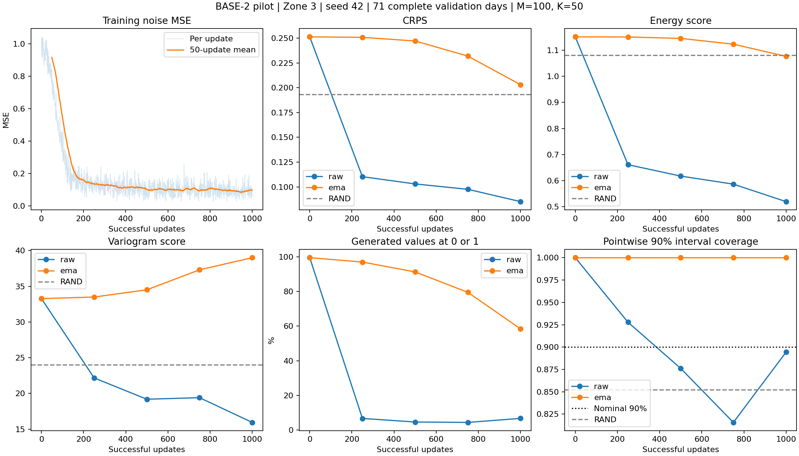

# BASE-2 真实数据学习性试验：seed 42

本轮仅运行 BASE-2，保持模型、损失、扩散过程、EMA 和数据协议不变。执行代码提交为 `1f2110a7aecdd0f75226a08ccc6de382e9227a25`；本次分支只增加试验记录和小型结果，不改变训练实现。

## 冻结设置

- 数据指纹：`403ff1adc1df6b1bd6dd79b24f206f164daf3161f829bf7a232fddf90a9168a4`。
- Zone 3；547 条训练窗口，全部 71 个完整有效验证日。测试集不评分。
- 新运行，不恢复接口检查点；seed=42，FP32，微批次 4，累积 8 次，有效批量 32。
- 预算为 1,000 次成功更新；验证节点为 0、250、500、750、1,000。
- 每个验证条件 100 条场景、50 步 DDIM、chunk size=16。验证噪声 seed=2026，RAND seed=2027。
- 检查点只按最低 EMA 验证 CRPS 选择，严格改善才替换；raw 只作诊断。RAND 从训练集抽完整轨迹，并在本轮面板上重新评分。
- 使用既有 `code_rl_clean` 环境和本机 RTX 2060（6 GB）。未安装依赖，未执行其他模型或 AMP 试验。

```bash
conda activate code_rl_clean
python train_real.py \
  --data outputs/data_v1_20261014/data.pt \
  --device cuda --updates 1000 \
  --microbatch-size 4 --accumulation-steps 8 \
  --validate-every 250 --scenarios 100 --sampling-steps 50 \
  --chunk-size 16 --seed 42 \
  --output outputs/real_base_pilot_v1_s42
```

启动后已断言 `validation_limit=null`、验证 ID 数量 71、场景数 100、采样步数 50、`resume_from=null`、`amp=false`。配置和小型 JSON 结果归档在 [`pilots/base_v1_s42/`](pilots/base_v1_s42/)。原始数据、目标张量、场景、检查点及包含真实功率的示例图只保存在本机 `outputs/real_base_pilot_v1_s42/`。

## 实测结果（2026-10-18）

已完成 1,000 次成功更新、0 次跳步，共暴露 32,000 条训练样本（允许重复）。本轮未重复运行历史 59 项单元测试；执行的是完整 FP32 学习性试验及产物一致性检查。

| 更新 | raw CRPS | EMA CRPS | raw 边界占比 | EMA 边界占比 |
| ---: | ---: | ---: | ---: | ---: |
| 0 | 0.251399 | 0.251399 | 99.48% | 99.48% |
| 250 | 0.110276 | 0.250913 | 6.71% | 96.96% |
| 500 | 0.102970 | 0.247234 | 4.64% | 91.26% |
| 750 | 0.097532 | 0.232003 | 4.40% | 79.49% |
| 1000 | 0.085117 | 0.203117 | 6.73% | 58.39% |

边界占比指所有生成值中恰为 0 或 1 的比例，不能单独判断真实边界概率是否正确。检查点规则选中第 **1,000** 次更新的 EMA；没有改选 raw。

| 模型／权重 | CRPS | ES | VS | 80% 覆盖率／宽度 | 90% 覆盖率／宽度 |
| --- | ---: | ---: | ---: | ---: | ---: |
| RAND | 0.193308 | 1.081198 | 24.012031 | 74.77% / 0.8044 | 85.21% / 0.8948 |
| BASE-2 raw @1000 | 0.085117 | 0.519614 | 15.939553 | 80.05% / 0.3883 | 89.44% / 0.4814 |
| BASE-2 EMA @1000 | 0.203117 | 1.076458 | 39.006529 | 100.00% / 0.9998 | 100.00% / 1.0000 |

前 100 次更新平均噪声 MSE 为 **0.733636**，最后 100 次为 **0.091146**。梯度范数均有限；训练更新计时合计 **99.78 秒**，不含验证采样、评分和保存，因此不能当作完整运行耗时或用于不同模型的成本比较。



## 判断与下一步

raw 的训练损失、CRPS、ES、VS 都较初始化改善，最终逐点覆盖率接近名义水平且区间明显收窄，说明 BASE-2 在这组真实数据上出现学习信号。不过 raw 的边界占比和 VS 并非逐节点单调改善，聚合覆盖率接近名义值也不等于各天气条件都校准。

第 1,000 次 raw 的逐日 CRPS、ES、VS 分别在 68/71、68/71、58/71 天优于 RAND；EMA 对应为 26/71、34/71、13/71。raw 的逐日 CRPS 差值中位数为 -0.09847，EMA 为 +0.01071。raw 的改善不只来自少数日期，但这些是同一个验证面板上的描述性结果，不是独立留出检验。

EMA 的 CRPS 虽从 0.25140 降至 0.20312，仍差于 RAND；VS 比初始化更差，90% 区间仍为几乎无信息的全范围区间。当前不能把所选 EMA 检查点称为可靠的概率基线。EMA 展开式中初始参数的系数在第 1,000 次更新仍为 `0.999^1000 ≈ 36.77%`，这为滞后提供解释，但不是预测中“未训练成分”的比例，也不是继续训练必然解决问题的保证。

下一步优先在同一 BASE-2 设置下研究训练长度和 EMA 滞后，继续同时观察 raw／EMA、逐日评分与采样诊断；本轮没有延长预算、修改 EMA、改选 raw，或启动 LOOP／UNTIED 对照。

## 交付与核对

已检查全部五个节点的 71 个样本 ID、数据指纹和 100 场景配置，确认 last/best 都对应第 1,000 次更新且无故障标记。最后选择结果与该节点 EMA 报告精确一致；用已保存的场景／目标在 CPU 上独立重评，所有非诊断报告字段也精确一致。

- [运行配置](pilots/base_v1_s42/config.json)、[训练历史](pilots/base_v1_s42/training_history.json)、[验证历史](pilots/base_v1_s42/validation_history.json)。
- [RAND 指标](pilots/base_v1_s42/rand/metrics.json)、[选中 EMA 指标](pilots/base_v1_s42/metrics.json)；各验证节点 raw／EMA 的完整 `metrics.json` 保留原目录结构。
- [逐日对照](pilots/base_v1_s42/daily_scores.csv)：按身份对齐的 CRPS（小时均值）、ES、VS 及相对 RAND 的差值；未上传目标值或场景张量。
- [数值汇总](pilots/base_v1_s42/summary.json)、[执行环境](pilots/base_v1_s42/execution_environment.json)、[小型产物 SHA-256](pilots/base_v1_s42/artifact_hashes.json)。
- 本机 `trajectory_examples.png` 固定展示按时间排列的第 1、36、71 个验证日的第 1,000 次 raw／EMA 场景区间；不按评分挑例子。该图含真实功率，未提交。

## 解释边界

结果仅代表这一个种子、这 71 个完整有效验证日；21/92 个候选日因缺失而排除，不能假设缺失随机。原始副本来源及实际 NWP 可用时间仍保留[数据协议](data_protocol.md)中的未核验标记。逐日差值用于诊断，不作为显著性检验；超过 RAND 不足以证明模型正确使用 NWP。未进行测试集评价或循环机制比较。
