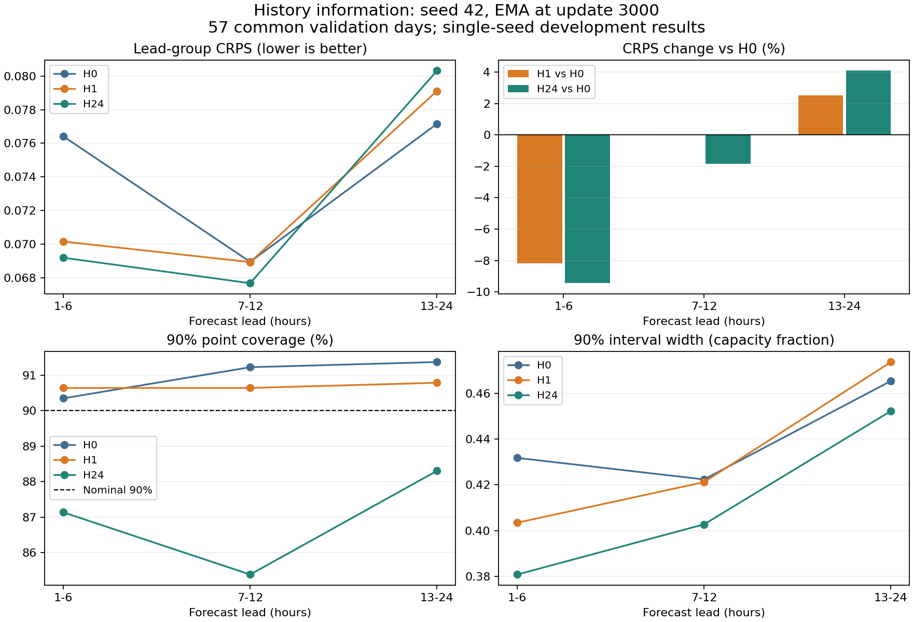

# H0／H1／H24：共同 48-token 接口与训练记录

## 实现范围

基于已审阅的 `05d8eb3`，完成同一 BASE 的历史输入、逐块 key/value 掩码、
DDIM 条件缓存、未来专属输出和组别绑定恢复。数据协议及指纹不变，时间戳语义
已在 [数据协议](history_information_v1.md) 补充为研究假设。
本轮仅三组 seed 42，未启动 LOOP／UNTIED、额外种子或测试评分。

历史 24 点由 `visible_history()` 完成一次 `2*y-1`，不可见值经 `torch.where`
清除后再投影；历史位置为 -24 至 -1，未来位置为 +1 至 +24。每个注意力块
都屏蔽不可见历史 key/value，避免它们成为可读回的额外计算位置。未来 token
保持双向注意力。三组参数量均为 **208,193**，包括同一个 `Linear(1,64)` 历史投影。

缓存字典同时保存未来条件、固定历史初始编码和布尔可见性；采样时按同一个
日期索引展开到场景。每个 DDIM 步重新构造 48-token 隐状态，历史隐状态可在
本次 Core 内变化，不跨扩散步传递。加噪、MSE、输出头读出、DDIM 状态和场景
始终只有未来 24 点。mask 在模型侧生成，不经过 Trainer 的统一浮点转换。

旧配置默认 `history_group=None`，继续走原路径。新历史包通过显式
`--history-group H0|H1|H24` 加载；检查点保存模型组别、历史接口版本、数据／协议
指纹和训练源码哈希。跨组、数据版本或源码不匹配时拒绝静默恢复，原故障快照
保护保持有效。恢复不重置优化器、数据位置、随机数或 EMA。

## 验收结果

- CPU 全量 unittest：**143 项，137 通过，6 项 CUDA 专用跳过**。
- 实际 RTX 2060 环境的历史接口套件：**8 项全部通过**，其中 1 项专门在 CUDA
  检查隔离、H0 等价性、训练／采样和恢复，其余覆盖 CPU 接口逻辑。
- 真实共同数据、完整宽度 64：三组分别连续训练 8 步，与 6 步＋正常断点恢复
  2 步逐位比较，raw／EMA、训练噪声和数据状态一致；场景形状均 `[2,4,24,1]`。
  验收临时 EMA 启动点为 3、验证为 2 日／4 场景／4 DDIM 步，不是正式实验。
- 直接回放 `05d8eb3` 的旧模型／Trainer 源码：BASE、LOOP、UNTIED 各 5 次更新，
  CPU 和 CUDA 的 loss、梯度、raw、EMA、加噪 RNG 均逐位一致。
- 旧实验和已审阅协议共 **2,176 个文件**保持哈希一致；数据包未重做。

环境：Python 3.10.20、PyTorch 2.10.0+cu128、RTX 2060 6GB。
短程真实数据验收的 PyTorch 峰值已分配显存为 26,242,560 字节；它不包含驱动等
全部显存，也不是完整 100 场景验证的资源测量。

隔离测试打开输出头和残差门。H0 全部历史、H1 前 23 点任意变化（含隐藏 NaN）
不影响输出及固定噪声的完整采样；H1 最新值和 H24 较早值的扰动能改变输出。
H0 与相同参数、未来 +1…+24 位置的 24-token 参考前向／采样在浮点容差内一致
（CPU 前向 `atol=2e-6, rtol=2e-5`，采样及 CUDA 前向 `3e-6, 3e-5`）。
缓存／直接前向、样本重排、chunk 切分和逐日单独采样一致；mask 逐块传入，
历史变换仅一次。正对照仅证明通路有效，不证明模型已经学会利用历史。

[验收清单与日志](experiments/history_information_v1/acceptance/acceptance.json)
保留对应源码和数据身份。复核使用：

```bash
CUDA_VISIBLE_DEVICES='' python -m unittest discover -s tests -v
python -m unittest discover -s tests -p test_history_interface.py -v
python -m diagnostics.check_history_interface \
  --data outputs/history_information_v1_20261103/data.pt \
  --output outputs/history_acceptance_new --device cuda
```

## 冻结运行与汇总

原三组计划文件保留为 `05d8eb3` 时的设计记录。
[execution.json](../configs/history_information_v1/execution.json) 是已实现的执行配置，
绑定这些计划、当前训练／汇总源码和数据哈希。队列按 **H0 → H1 → H24** 顺序执行，
每次完成后检查初始化／随机数／EMA／检查点身份；异常即停止，不自动覆盖或重跑。

```bash
python -m diagnostics.run_history_information
```

正式规则仍是：545 个训练窗口、57 个验证日，FP32，4×8 有效批量，seed 42，
各 3,000 次成功更新。第 1,000 步复制 raw 为 EMA，此后衰减 0.999。每 250 步
验证，100 场景、DDIM50、chunk 16。每个保存面板记录初始采样噪声哈希，供跨组核对。
主表为第 3,000 步最终 EMA；辅助 best 在 1000、1250、…、3000 中按 CRPS 选择。
RAND 在共同面板重算，仅抽共同训练集完整轨迹。

完成后自动输出 `outputs/history_information_v1_results/`：完整轨迹分数、逐日分数、
1–6／7–12／13–24 小时 CRPS／覆盖率／宽度、三个配对差值及逐日配对差值、
训练／验证历史和成本。主表、辅助 best、RAND 分开保留。独立重评分按样本身份
连接，不把不同日期当作同一天；不将 57 日当作 57 次独立训练。

截止本实现验收记录，正式三组结果仍待产生。历史收益、H24 相对 H1 的增益和
提前量分布必须由固定实验回答，不据短程验收作预测结论。

### 启动记录

训练实现冻结于 `6c6f4b6`。2026-11-03 已在本机 RTX 2060 启动有界队列，首组为
H0；主机进程与 GPU 活动已确认。H0 的运行配置与冻结执行配置逐项一致，初始
参数哈希与 GPU 短程验收一致；全部 57 个验证日、100 场景和 DDIM50 已核对。
进度文件为 `outputs/history_information_v1_queue.json`，状态仍为运行中，未预先
宣称三组完成或历史条件有收益。原始数据、场景和检查点继续仅保留在本地。


## 正式三组已完成（2026-11-04 复核）

H0、H1、H24 均从头完成 **3,000 次成功更新，跳步为 0**，每组训练样本暴露量
96,000。运行与配对审计通过：共同初始化相同，训练噪声和数据迭代器状态匹配，
延迟 EMA 时钟正确，验证初始噪声哈希相同。原数据包、训练设置和可见性规则未变。
队列与自动汇总于 **2026-11-04 01:26:09（Asia/Shanghai）** 完成，总耗时约
**93.64 分钟**（含训练、验证、保存与自动汇总）。

三组辅助 best 均选中第 3,000 步，所以此次辅助表与固定终点主表的分数相同；
两套产物仍分别保存。下面所有模型结果均为 **seed 42、57 个共同有效验证日、
100 场景、DDIM50、第 3,000 步最终延迟 EMA 读出**。测试集未评分。

### 主结果

| 组别 | CRPS | ES | VS | 1h 增量 CRPS | 3h 增量 CRPS | 日均功率 CRPS |
|---|---:|---:|---:|---:|---:|---:|
| H0 | 0.074919 | 0.462751 | 14.516202 | 0.050975 | 0.086097 | 0.036394 |
| H1 | 0.074328 | 0.455660 | 14.039375 | 0.050921 | 0.085970 | 0.036237 |
| H24 | 0.074377 | 0.455977 | 13.974425 | 0.051606 | 0.085051 | 0.036270 |
| RAND | 0.195903 | 1.094690 | 24.675563 | 0.056100 | 0.109241 | 0.148137 |

RAND 仅从 545 个共同训练窗口抽取整条轨迹，在三组中逐位一致。
旧 71 日 BASE 不是此表对照；本轮 H0 使用相同的新接口和共同训练／验证日期重新训练。

| 组别 | 80% 点覆盖率 | 80% 宽度 | 90% 点覆盖率 | 90% 宽度 |
|---|---:|---:|---:|---:|
| H0 | 82.24% | 0.359830 | 91.08% | 0.446282 |
| H1 | 81.07% | 0.357677 | 90.72% | 0.443049 |
| H24 | 76.61% | 0.336415 | 87.28% | 0.422035 |

### 配对差值与提前量

以下为左组减右组，CRPS 越低越好；百分比相对右组。逐日数量只是同一模型面板
的描述，不是独立训练重复，也不是显著性检验。

| 比较 | 平均 CRPS 差值 | 相对变化 | CRPS 更好的日期 |
|---|---:|---:|---:|
| H1−H0 | -0.000590933 | -0.789% | 31/57 |
| H24−H0 | -0.000541660 | -0.723% | 31/57 |
| H24−H1 | +0.000049273 | +0.066% | 29/57 |

| 提前量 | H0 CRPS | H1 CRPS | H24 CRPS | H1 相对 H0 | H24 相对 H0 |
|---|---:|---:|---:|---:|---:|
| 1-6 h | 0.076414 | 0.070157 | 0.069194 | -8.19% | -9.45% |
| 7-12 h | 0.068948 | 0.068933 | 0.067678 | -0.02% | -1.84% |
| 13-24 h | 0.077157 | 0.079111 | 0.080319 | +2.53% | +4.10% |

整日 CRPS 按小时平均，三个提前量组的权重为 6/24、6/24、12/24，不能将三个
组均值等权平均。历史组前 6 小时改善，而后 12 小时恶化，解释了整日收益较小。
H24 在 7–12 小时也有改善，但并未形成优于 H1 的整日平均 CRPS／ES。



### 本轮可以支持的判断

最近功率值在这个种子、当前训练预算下提供了近端预测的信息：H1 的前 6 小时
CRPS 改善约 8.19%，整日 CRPS 改善约 0.79%，ES／VS 均改善。H1 的 90% 覆盖率
为 90.72%，宽度略窄于 H0；但整日 CRPS 仅 31/57 天更好，收益不是逐日一致的。

**没有发现 H24 相对 H1 的明确整体优势。** 两者整日 CRPS 很接近；H24 的 VS、
3h 增量评分略好，但 1h 增量评分更差，且仅 12/57 天的 1h 增量 CRPS 优于 H1。
H24 区间进一步变窄，90% 覆盖率却降至 87.28%（80% 覆盖率 76.61%），不能将更窄
直接解释为更好的概率分布。它在三个提前量组的 90% 覆盖率都低于名义水平。

这是单种子开发筛查，不能证明历史普遍无用，也不能把近端信号解释成复杂历史
轨迹理解或循环优势。H1 已取得大部分整日平均收益，H24 的额外价值仍不清楚。
三组到此停止，不自动增加训练预算、种子、历史长度或 LOOP／UNTIED 矩阵。
是否采用 H1／H24 作为后续条件，应依据这份完整结果另行冻结；本次不事后改选
某个提前量指标、raw 权重或新的检查点规则。

57 个验证日已用于多轮开发，且历史完整性筛选改变了面板；结果首先适用于这批
完整日期和当前可用性假设。不能用 57 天代替独立训练种子，不能外推全年或业务
发布延迟，也未使用封存测试集来选择历史长度或架构。

### 成本、复核与归档

三组参数量均为 208,193，未来任务均 24 小时，内部序列长度均 48。

| 组别 | 3,000 次训练更新累计时间 | 固定终点 57×100 场景采样时间 |
|---|---:|---:|
| H0 | 289.97 s | 57.97 s |
| H1 | 286.27 s | 57.26 s |
| H24 | 287.27 s | 56.76 s |

训练列只计同步的 `train_update`，不含验证、检查点 I/O；不能把它当总运行时间。
采样时间来自不同运行时段的实测，细小差异不构成稳定加速结论。

自动汇总独立重评了主结果、辅助 best 和 RAND 的九份场景／目标，并校验原有
CRPS／ES／VS 和逐窗口数组。2026-11-04 的归档复核进一步确认：

- **2,581 个受保护产物哈希**及冻结源码／计划哈希一致；三组退出码均 0，审计通过。
- 513 行逐日评分、1,539 行逐日提前量评分与汇总均值一致（容差 `1e-10`）。
- 6／6／12 小时加权平均还原整日边际指标；四份配对 CSV 的差值一致（`1e-12`）。
- 提前量图已目视检查；本轮仅新增报告与绘图，没有重新训练，也未重跑此前验收测试。

[完整汇总](experiments/history_information_v1/results/summary.json)、
[逐日配对](experiments/history_information_v1/results/paired_daily_effects.csv)、
[提前量配对](experiments/history_information_v1/results/paired_lead_effects.csv) 与
[复核记录](experiments/history_information_v1/results/review.json) 已归档。
各组配置、完整验证曲线、训练端点和 SHA-256 清单随报告保存。
完整训练历史、逐提前量张量、场景和检查点留在本地
`outputs/history_information_v1_results/` 及三个原运行目录。
