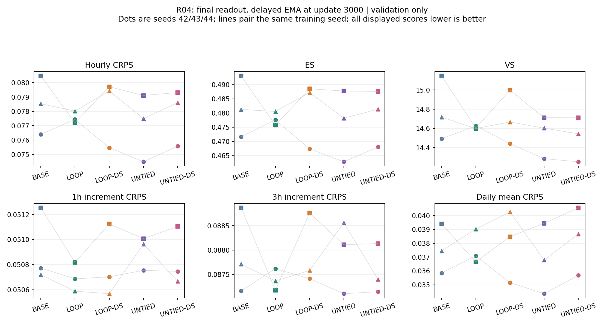

# R04: intermediate supervision with a shared output head

## Frozen question and four-cell comparison

Based on `0e0c685`, R04 tests a new training constraint, not a repair for a
confirmed defect. Existing LOOP/UNTIED final-only seeds 42/43/44 supply two
cells; six new runs supply LOOP-DS/UNTIED-DS at those same seeds. Historical BASE
remains the shallow reference. R01–R03 and LOCAL results remain unchanged.

One pass produces H1 then H2. The same existing output head reads both states;
LOOP reuses Core0 and UNTIED uses Core1 at its second stage. The loss is
`0.5*MSE(eps1.float(), noise.float()) + 0.5*MSE(eps2.float(), noise.float())`.
Both losses use identical noisy input, timestep, conditions and noise target.
There is no detached state, extra head, embedding, loss, recurrence depth or
input branch. Weights sum to one to avoid an arithmetic doubling of loss;
this does not guarantee matched gradient magnitude, direction or optimization.
Parameter counts remain 208,065 (LOOP) and 365,697 (UNTIED).

Final-only retains the original model call and loss branch and does not compute
intermediate predictions/losses. Sampling and validation use the final readout
only, never averaging the two predictions. The optional `forward_stages` path
calls each stage once, calling the same head twice within that pass.

## Configuration and checkpoint identity

`TrainConfig.supervision_mode` defaults to `final-only`; missing legacy
`loss_weights` default to `[0,1]`. DS uses `intermediate` with `[0.5,0.5]`.
Both fields are stored in checkpoints and run configs. Explicit resume flags
must match saved values before trainer construction/RNG changes; omitted flags
inherit the saved mode. Old v1/v2 checkpoints keep final-only behavior. JSON
lists and checkpoint tuples are compared through normalized TrainConfig values,
including old best checkpoints. Mode/weight mismatches are rejected.

All six formal runs start from matched random initialization, not trained
checkpoints. The existing v2 recipe is frozen in
`configs/intermediate_supervision_v1.json`: Zone 3, original fingerprint and
547/71/90 split; full attention, two Core executions; FP32, effective batch 32,
AdamW and clipping unchanged; 3,000 successful updates; EMA copied at 1,000 then
averaged at 0.999. Use all 71 validation days, 100 scenarios, 50 DDIM steps,
chunk size 16, validation every 250. Init/data/noise RNG streams match the
same-seed corresponding original architecture; validation seed 2026 and RAND
seed 2027 remain fixed. Test data is not scored.

Order: seed 42 LOOP-DS then UNTIED-DS, followed by the same order for 43 and 44.
No recipe change depends on early scores. Each completion must pass artifact,
EMA, initial-state, final RNG/data-position and scoring audits before advancing.
On any failure the queue stops for inspection and never overwrites old outputs.
There is no automatic extension, extra seed, weight search or R05/R06 run.

## Evaluation and interaction

Primary: final-readout delayed EMA at update 3,000. Auxiliary best: final-readout
EMA validation CRPS at the nine common nodes 1,000–3,000, earlier ties. Neither
intermediate MSE nor transformed scores select checkpoints. DS logs retain
loss1, loss2 and loss_total (`loss` remains an alias for total); these training
losses are not directly equivalent to original final-only training losses.

Score CRPS, ES, VS, 1h/3h increment CRPS, daily-mean-power CRPS, point coverage and
width at 80%/90%, plus parameter count, synchronized update cost and sampling
latency. Reuse the existing identity-aligned evaluators and R01 transformations.
Per-lead arrays stay local; per-day and per-seed values are retained. Report
absolute model scores alongside paired supervision effects within each seed:

- delta_loop = LOOP-DS minus LOOP-final;
- delta_untied = UNTIED-DS minus UNTIED-final;
- interaction = delta_loop minus delta_untied.

For lower-is-better scores a negative interaction means larger improvement for
LOOP, not necessarily better absolute quality than UNTIED or BASE. Coverage must
be judged against its nominal level and width jointly; smaller coverage is not
an improvement. Average days within each trained model, then report all three
seed differences, their mean and sample SD. The 71 days are not independent
trainings; SD is descriptive, not a confidence interval. No result is chosen
based on which table favors LOOP. All conclusions remain development evidence.

## Checks and execution

Nonzero output heads and active attention/FFN gates are used in gradient tests.
Tests check single-pass Core/head counts, exact final-output equivalence, the
weighted gradient identity, final-loss gradient through H1, and UNTIED's
first-loss exclusion of Core1 versus final-loss access to both Cores. They also
check matched parameters/RNG, exact continuation before/after EMA start,
legacy best restore, mode/weight rejection, final-only sampling, and complete
four-cell interaction accounting. A small real-entry fixture tests loss-weight
list/tuple identity through independent saved-artifact re-scoring.

```bash
python -m unittest discover -s tests -v
python -m diagnostics.run_intermediate_supervision
```

The queue checks frozen training/diagnostic hashes and original artifact hashes,
then writes independent `outputs/intermediate_v1_s{seed}_{variant}` directories.
After six successful audited runs it automatically writes the read-only report
to `outputs/intermediate_supervision_v1_results`, including primary/best tables,
paired daily effects, per-seed interactions, learning histories and a figure.
No additional R03-style readout diagnostic is required or launched in this v1.

## Engineering acceptance and launch record

Engineering acceptance is complete. Training and reporting sources were frozen
in `cd57515`; the six-run queue has started with seed-42 LOOP-DS. Startup checks
confirmed exact historical LOOP initialization and the unchanged 71-day evaluation
panel. Formal results are still pending. CPU regression: **123 total, 118 passed, 5 CUDA-only skipped**.
The **8 R04 supervision tests all passed in the actual RTX 2060 environment**,
including CUDA FP32 updates/resume and final-only sampling (other tests in that
suite use CPU). Environment: Python 3.10.20, PyTorch 2.10.0+cu128. Gradient tests
use nonzero head/gates and test `0.5*g1+0.5*g2` at `atol=2e-6, rtol=1e-4`.

A direct replay against model/trainer source from `0e0c685` also passed on **both
CPU and CUDA**: BASE, LOOP and UNTIED each performed five synthetic updates, with
bitwise-equal loss records, gradients, raw/EMA tensors and training-noise RNG
states at every update. This short replay certifies the tested calculations;
it is not a new scientific training run or a claim of long-run equivalence on
all hardware. Seed-42 historical LOOP/UNTIED primary and best artifacts were
independently re-scored under the normalized checkpoint auditor successfully.
Syntax and whitespace checks passed; all 129 protected reference files matched.

[Acceptance logs and replay records](diagnostics/intermediate_supervision_v1/acceptance/)
are archived. The replay script was invoked from the repository root with
`PYTHONPATH=. python outputs/check_r04_legacy_replay.py cpu` and `cuda`; archived
source identifies its exact historical comparison. No R04 forecasting outcome
has been observed or claimed at this point.

### Interrupted seed-44 queue and bounded continuation (2026-11-02)

The first four runs (seeds 42/43, LOOP-DS and UNTIED-DS) completed 3,000 updates
and passed the queue's artifact and paired-training audits. The original queue
and seed-44 LOOP child were absent on the host when checked; the GPU was idle.
The interruption cause and exit code are unknown. Its last normal checkpoint
contains 1,999 successful updates, zero skipped updates, and no failure flag.
The matching best checkpoint at update 1,750 remains available.

`configs/intermediate_supervision_v1_resumed.json` retains the frozen protocol
and adds the continuation segment. `python -m diagnostics.resume_intermediate_supervision`
resumes exactly 1,001 updates into `outputs/intermediate_v1_s44_loop_resumed`,
then runs the previously unstarted seed-44 UNTIED-DS for 3,000 updates. Original
run artifacts are hash-protected and retained; the original queue status is
archived locally. The first four runs are not repeated. Optimizer, EMA, data
position and RNG are restored, without changing supervision or evaluation.

The resumed update-1,999 evaluation is diagnostic and is excluded from the
common best-selection nodes. The final report stitches the two LOOP segments;
recorded training cost covers retained completed updates, not unknown work lost
during interruption. No test scoring or extra training budget is added.

## Completed R04 results (reviewed 2026-11-03)

All six new runs completed 3,000 successful updates and passed the paired
initialization, data/noise RNG, recipe, checkpoint and loss-accounting audits.
The final queue/report completed at **2026-11-02 23:58:56 Asia/Shanghai**.
Seed-44 LOOP used the recorded 1,999 + 1,001 continuation; its original
interrupted segment has an unknown exit code, retained without alteration.
All 15 models selected update 3,000 for the auxiliary best table, so its
scores equal the primary table. No extra training or test scoring was started.

### Fixed-endpoint means across three training seeds

Scores below are means of the three seed-specific 71-day averages. Lower is
better for the six scoring rules; coverage must be compared with its nominal
level and width interpreted together with coverage.

| Model | CRPS | ES | VS | 1h increment CRPS | 3h increment CRPS | Daily-mean CRPS |
|---|---:|---:|---:|---:|---:|---:|
| BASE | 0.078467 | 0.481974 | 14.784732 | 0.050915 | 0.087914 | 0.037564 |
| LOOP | 0.077553 | 0.477935 | 14.608677 | 0.050697 | 0.087387 | 0.037587 |
| LOOP-DS | 0.078200 | 0.481039 | 14.701380 | 0.050798 | 0.087919 | 0.037961 |
| UNTIED | 0.077032 | 0.476240 | 14.531945 | 0.050908 | 0.087925 | 0.036859 |
| UNTIED-DS | 0.077826 | 0.478968 | 14.501207 | 0.050839 | 0.087561 | 0.038306 |

| Model | 90% point coverage | 90% width | Retained training updates (s) | Primary-panel sampling (s) |
|---|---:|---:|---:|---:|
| BASE | 89.28% | 0.438930 | 282.18 | 67.60 |
| LOOP | 90.20% | 0.441130 | 421.56 | 107.19 |
| LOOP-DS | 90.41% | 0.450437 | 446.04 | 104.55 |
| UNTIED | 90.00% | 0.435382 | 438.54 | 106.65 |
| UNTIED-DS | 90.49% | 0.449484 | 461.22 | 106.57 |

Training seconds sum recorded completed-update durations, excluding validation,
reporting and unrecorded work lost during interruption. They are not total run
wall time. Sampling times are measured for the same 71 x 100-scenario panel;
they are descriptive measurements across separate runs, not controlled latency
benchmarks. DS retains final-only inference and adds no inference parameters.

### Paired supervision effects

Positive score deltas mean deterioration. Interaction is delta_LOOP minus
delta_UNTIED; a negative interaction alone does not establish an absolute win.

| Seed | LOOP-DS minus LOOP CRPS | UNTIED-DS minus UNTIED CRPS | Interaction |
|---|---:|---:|---:|
| 42 | -0.001962963 | +0.001084370 | -0.003047332 |
| 43 | +0.002507702 | +0.000201498 | +0.002306204 |
| 44 | +0.001397954 | +0.001096470 | +0.000301484 |
| Mean | +0.000647565 | +0.000794113 | -0.000146548 |
| Sample SD (n-1) | +0.002327880 | +0.000513255 | +0.002704743 |

LOOP-DS worsened mean CRPS by **0.84%** relative to LOOP (one seed improved,
two worsened); UNTIED-DS worsened it by **1.03%** (all three worsened). LOOP-DS
also worsened the mean of each of the other five scoring rules. UNTIED-DS
slightly improved VS and 1h/3h increment scores while worsening ES and
daily-mean CRPS. Thus the results are mixed across targets, not universal
deterioration. Both DS variants widened intervals; their mean 90% coverage
moved slightly above the already near-nominal final-only coverage.

The CRPS interaction is -0.000147 with sample SD 0.002705 and changes sign
across seeds. This does **not** support a stable sharing-specific benefit.
The fixed half/half intermediate-supervision recipe has not established a
useful final-generation improvement. Freeze this result; do not automatically
search weights, add rounds, or extend training. No intermediate-readout MSE
experiment was run, so this report makes no claim that first-stage MSE improved.

These remain development results on the repeatedly used 71 complete validation
days. Three seeds are three training replicates, not 213 independent model
experiments; the test set remains unscored.

### Review and artifacts

The automatic report independently re-scored all 30 saved primary/best panels
and checked agreement with existing CRPS/ES/VS. On 2026-11-03, archival review
rechecked **2,139 protected file hashes**, all 2,130 daily rows against panel
means (1e-10), and paired effects/seed SD (1e-12); the plot was inspected.
No implementation changed during this archival review and the earlier test
suite was not rerun. Acceptance counts above remain the recorded prior runs.

[Archived results, configurations, evidence and per-day differences](diagnostics/intermediate_supervision_v1/results/summary.json)
include CSV tables, six validation histories, training endpoint excerpts and
an archive SHA-256 manifest. Full training histories, per-lead score tensors,
scenarios and checkpoints remain under local `outputs/`.


