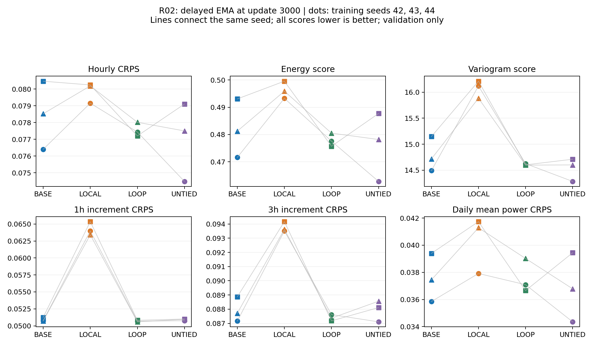

# R02: strictly hourly conditional reference (LOCAL-2)

## Frozen question and scope

Based on `ef50c1b`, R02 removes cross-hour information exchange from BASE-2 and
trains from scratch. R01's shuffled outputs are not a trained local reference.
Existing nine v2 runs and R01 are retained unchanged. Only LOCAL-2 seeds 42, 43,
44 are authorized; R03 and subsequent stages remain unstarted.

## Model and checkpoint identity

LOCAL-2 is `variant="base", attention_scope="diagonal"`. Boolean SDPA masks allow
only the diagonal (True means allowed). All encoders, hourly positions, adapters,
AdaLN, FFN, output head and initialization remain matched. Each denoising call
executes one two-block Core. No history, convolution, extra loss or recurrence
is introduced. There are 208,065 parameter elements, matching BASE. A single
allowed key makes Q/K irrelevant to attention weights in exact arithmetic;
floating-point kernels can leave tiny gradient residuals. This is an interaction
ablation, not equal effective capacity or equal FLOPs. The dense masked operator
is retained; measured timings describe this implementation, not an optimized MLP.

Absent `attention_scope` defaults to `full`, with the historical SDPA call intact.
The field is saved in model config and checked when explicitly supplied on resume.
An omitted resume flag inherits the saved scope. Old best-checkpoint comparisons
normalize missing defaults. Tensor state dictionaries alone do not identify the
scope; use the saved model configuration when loading weights.

## Frozen experiment

`configs/local_attention_v1.json` pins source/data hashes, original artifact hashes,
all 71 validation IDs, ordered runs, and the unchanged v2 recipe: Zone 3,
547/71/90 windows; FP32; microbatch 4 × accumulation 8; 3,000 successful updates;
EMA copies raw at 1,000 and averages with 0.999 thereafter. Validate every 250
updates with 100 scenarios, 50 DDIM steps and chunk size 16. Initialization, data
order and training-noise streams match the same-seed historical BASE; validation
seed 2026 and RAND seed 2027 stay fixed. The test split is not scored.

Primary comparison: delayed EMA at update 3,000, LOCAL minus same-seed original
BASE. Auxiliary best: minimum EMA validation CRPS at the nine common nodes
1,000–3,000, earlier ties. Increment scores do not select checkpoints. Report
CRPS, ES, VS, 80%/90% point coverage and width, signed 1h/3h increment CRPS and
daily-mean-power CRPS, together with per-day differences and measured costs.
Average days within each trained model, then report the three paired seed
differences, mean and sample SD. Days are not independent training repetitions.
LOOP and UNTIED remain contextual references. No scoring-driven recipe changes.

## Verification and execution

Tests explicitly open the zero output head and attention residual gates. For
noisy power, NWP and calendar perturbations, LOCAL must isolate other hours and
the matched full-attention positive control must detect cross-hour changes.
Complete DDIM chains use fixed initial noise; both condition types are checked.
Tests also cover historical full execution, matched initialization/RNG, legacy
best resume, scope mismatch rejection before RNG mutation, and exact continuation.

```bash
python -m unittest discover -s tests -p test_local_attention.py -v
python -m diagnostics.run_local_reference
```

The queue refuses existing runs, checks frozen hashes before each launch, and
stops on failure. Seed 42 must pass endpoint, initialization, RNG, EMA and scoring
audits before 43 and 44 start; its numerical ranking is not a gate. Logs and full
checkpoints remain under `outputs/local_v2_s{seed}`. Interruptions require inspection
and a new resume segment, never deletion or replacement of old artifacts.

## Status

Training implementation and the predeclared run configuration were frozen in
`46360ec`. CPU regression: **104 tests, 100 passed, 4 CUDA-only skipped**
(Python 3.10.20, PyTorch 2.10.0+cu128; CUDA unavailable inside the sandbox).
The **7 LOCAL-specific tests all passed on the actual RTX 2060**, including
FP32 optimizer updates and exact resumed continuation. CPU logs are
`outputs/r02_tests_cpu.log`; GPU-specific logs are `outputs/r02_tests_cuda.log`.
The two report tests check seed-level pairing and reject scope, initialization,
protocol, sample identity, RNG and data-position drift. Syntax and whitespace
checks passed. These are engineering results, not forecasting outcomes.

All three runs finished successfully, with no skipped updates or resume segments.
The automatic report completed after all engineering gates passed. The commands
below reproduce the report (choose a new output directory; existing outputs are
intentionally rejected):

```bash
python -m diagnostics.summarize_local_reference \
  --output outputs/local_attention_v1_results
MPLCONFIGDIR=/tmp/loop-pilot-mpl python -m diagnostics.plot_local_reference \
  --results outputs/local_attention_v1_results \
  --output outputs/local_attention_v1_results/comparison.png
```

The summary re-scores primary and auxiliary-best saved panels for all 12 models
(nine historical plus three LOCAL), preserving per-lead arrays locally and
per-day CSVs. It verifies original input hashes before and after scoring. LOCAL
initial tensors and final data/noise RNG positions must match same-seed BASE.
Training costs exclude validation and checkpoint I/O; observed latency is not
a theoretical FLOP comparison. The old BASE primary/best panels for seed 42 have
already been independently re-scored successfully with the unchanged evaluator.

## Completed experiment and interpretation

All three LOCAL runs reached 3,000 successful updates, with 96,000 training-window
exposures each and 2,000 EMA averaging updates after the exact copy at 1,000.
The queue ran for 104.2 minutes, including validation and checkpoint I/O; final
report generation took less than a minute. Seed 42 used source commit `46360ec`;
43 and 44 used `1c05c50`. All three have identical frozen training-source hashes;
the intervening commits only added reporting/tests/docs. Recorded Python is
3.10.20, PyTorch 2.10.0+cu128, GPU RTX 2060. The original nine runs were not repeated.

The 24 primary/best saved panels passed independent re-scoring. Initialization
hashes and final training-noise/data RNG positions matched historical same-seed
BASE. All 1,670 protected artifact hashes were rechecked after scoring and remain
unchanged. A separate CSV review verified 24 × 71 unique sample identities,
per-day reaggregation and all 426 paired daily rows at `atol=rtol=1e-12`.
These are new artifact checks; the CPU/GPU regression results above were not
rerun during this documentation-only completion.

### Primary endpoint: LOCAL versus BASE

Three-seed means follow. Positive score changes are worse. Percentages divide
the difference of model means by the BASE mean; they do not rank the importance
of different temporal scales or establish statistical significance.

| Metric | BASE | LOCAL | Relative change |
|---|---:|---:|---:|
| Hourly CRPS | 0.078467 | 0.079864 | +1.78% |
| ES | 0.481974 | 0.496249 | +2.96% |
| VS | 14.784732 | 16.072396 | +8.71% |
| 1h increment CRPS | 0.050915 | 0.064248 | +26.19% |
| 3h increment CRPS | 0.087914 | 0.093765 | +6.66% |
| Daily-mean-power CRPS | 0.037564 | 0.040312 | +7.32% |

Mean 90% point coverage falls from **89.28% to 85.70%**, while mean interval
width falls from **0.43893 to 0.41418**. Narrower intervals therefore are not an
unqualified improvement. Both 80% and 90% per-day results are in the archive.

| Training seed | BASE CRPS | LOCAL CRPS | LOCAL − BASE |
|---|---:|---:|---:|
| 42 | 0.076405 | 0.079158 | +0.002753 |
| 43 | 0.080470 | 0.080245 | -0.000224 |
| 44 | 0.078527 | 0.080189 | +0.001662 |

CRPS is slightly better for LOCAL in seed 43 and worse in 42/44. All five
structural scores (ES, VS and the three transformed CRPS scores) are worse for
LOCAL in **each** training seed. Paired difference mean and sample SD across
three training seeds are:

| Metric | Mean LOCAL − BASE | Sample SD |
|---|---:|---:|
| Hourly CRPS | +0.001397 | 0.001506 |
| ES | +0.014275 | 0.007590 |
| VS | +1.287664 | 0.300157 |
| 1h increment CRPS | +0.013333 | 0.000712 |
| 3h increment CRPS | +0.005852 | 0.000526 |
| Daily-mean-power CRPS | +0.002748 | 0.000954 |

These SDs are descriptive, not confidence intervals. Each seed has 70/71 days
with worse LOCAL 1h-increment CRPS, whereas daily-mean CRPS worsens on only
32/71, 35/71 and 38/71 days for seeds 42, 43 and 44. Negative daily differences
are retained; aggregate worsening is not uniform day-by-day worsening. The
71 shared validation days are not 71 independent model fits.

All 12 models select update 3,000 under the unchanged auxiliary best-CRPS rule.
The separate best table is retained even though its score values coincide with
the primary table. Sampling times can differ between the two evaluations.

### What this supports

At this frozen budget, hourly CRPS is comparatively close, but removing
cross-hour interaction consistently worsens joint, increment and daily-aggregate
scores. Together with R01, this supports a useful role for temporal information
exchange that hourly CRPS alone understates. Ordinary BASE-2 already captures
much of this benefit. R02 does **not** establish that recurrence is necessary,
or that temporal dependence alone explains the difference: full attention can
also use neighboring weather and noisy-power information, and diagonal attention
changes the effective role of Q/K. No equivalence or significance test was used
to declare the marginal scores "the same".

The mean synchronized training-update totals are 282.18 s for BASE and 281.98 s
for LOCAL; primary-panel sampling times average 67.60 s and 72.57 s respectively.
These are observed timings of a dense masked implementation across separate
runs, excluding validation/IO from training-update cost. They establish neither
a speed benefit nor equal theoretical computation/effective capacity. Parameter
elements remain 208,065 in both models.

Development evidence remains limited to three seeds and 71 complete validation
days (21/92 candidate days were excluded). Repeated validation use, unresolved
original-source/NWP availability evidence and limited season coverage remain
unchanged. No test scores were computed. R03 and all later stages are unstarted;
this result supplies a basis for deciding the next mechanism diagnostic, not
permission to launch further training or expand recurrence depth.

### Archived evidence

[Summary and all model rows](diagnostics/local_attention_v1/summary.json),
[paired seed differences](diagnostics/local_attention_v1/paired_seed_differences.csv),
[paired daily differences](diagnostics/local_attention_v1/paired_daily_differences.csv),
[all per-day scores](diagnostics/local_attention_v1/scores_per_day.csv),
[artifact audits](diagnostics/local_attention_v1/evidence.json) and
[completion checks](diagnostics/local_attention_v1/verification.json) accompany
full LOCAL learning histories, configs, lineages and test logs in the archive.
Raw data, checkpoints, scenarios and per-lead tensors remain local under
`outputs/`; archive checksums also identify the local per-lead tensor file.



Circle = seed 42, square = seed 43, triangle = seed 44. Lines connect the same
training seed, not a sequence of progressively trained models. LOOP/UNTIED are
unchanged contextual references, not new R02 training runs.
