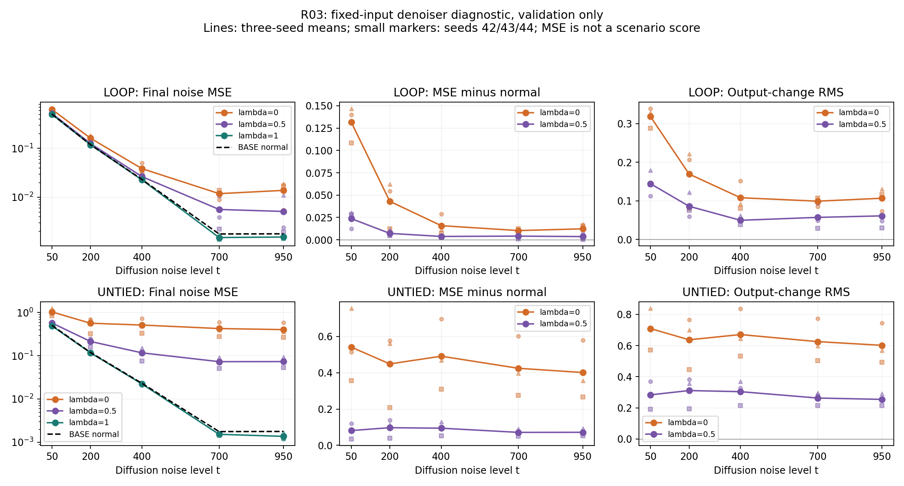

# R03: use of the first Core's state

## Frozen question and scope

Based on `0323751`, this read-only diagnostic asks whether retaining the first
Core's state improves the final noise estimate. It uses the nine original v2
BASE/LOOP/UNTIED delayed-EMA checkpoints at successful update 3,000. LOCAL is not
retrained or included. There is no new training, DDIM trajectory sampling, test
scoring, extra depth, intervention tuning or R04 execution. Formal model,
training, diffusion and evaluation implementations are unchanged.

## Panel and intervention

`configs/diagnostics/loop_state_usage_v1.json` freezes the 71 validation IDs,
source/data/checkpoint hashes, times 50/200/400/700/950 and noise seeds
3101–3104. Each local CPU RNG generates one FP32 `[71,24,1]` Gaussian tensor;
these same four tensors are reused at every time and for every model/seed/branch.
Thus every model sees 1,420 fixed day–noise–time inputs. True validation power
is used only to construct `x_t = a_t*(2*y-1) + sigma_t*epsilon` and evaluate
injected-noise MSE; it is never supplied as an extra network condition.

Inference uses CPU FP32, `eval()`, disabled gradients and batches of 16; MSE and
RMS reductions use FP64. CPU diagnostics do not certify GPU numerical identity
or latency. The saved training-only scaler is checked against the data manifest.

LOOP computes H0=E and H1=Core0(H0,E,t). Its second call receives H0, the midpoint
H0+0.5*(H1-H0), or H1, corresponding to lambda 0, 0.5 or 1. UNTIED receives the
same interventions but executes Core1 on the second call. BASE executes its
single Core once and has only the normal branch. E, t and input noise are fixed
throughout; the output head is called after the final Core.

Endpoint lambdas use H0/H1 directly to avoid interpolation cancellation error.
Every normal branch is checked against official `forward`; LOOP reset is checked
against `forward(..., rounds=1)` at FP32 `atol=1e-6, rtol=1e-5`. This single readout
is from the **two-round-trained** model and is not a separately trained BASE.

## Measurements and aggregation

For each fixed input and branch, retain noise MSE and its difference from normal,
output-change RMS, first-update RMS (H1-H0), second-input-change RMS (H_lambda-H1)
and final-state-change RMS relative to normal. RMS averages all nonbatch axes.
BASE has zero intervention-change values; first-update RMS is still reported.
Hidden norms are descriptive and not directly comparable measures of usefulness
across different learned representations. Finite values are required.

Average the four noises **within each day**, then average the 71 days within
each trained model. Preserve separate rows for every t, training seed and lambda;
there is no pooled headline across noise levels. Three-seed means and sample SDs
use the training seed as their unit, not days or noise repeats. Positive delta
MSE means normal state retention had lower error; negative values are retained.
There is no significance threshold or search for the best intervention.

## Verification and reproduction

Tests activate nonzero output heads and residual gates. They cover official
forward equivalence, the LOOP reset identity, use of UNTIED's distinct second
Core, helpful and harmful state interventions, and nonzero hidden changes with
no output influence. Additional checks cover batch partitioning, fixed-noise RNG
isolation, checkpoint identity, frozen-grid and output protections, and correct
nested aggregation with missing/duplicate observations rejected.

```bash
python -m unittest discover -s tests -p test_loop_state_usage.py -v
python -m diagnostics.loop_state_usage --output outputs/loop_state_usage_v1
```

The script rejects existing outputs and overlaps with source runs, verifies
protected file hashes before and after execution, and compares all model
parameters/buffers before and after inference. Noise hashes, sample metadata,
checkpoint hashes, equivalence errors and execution provenance are saved with
per-input, per-day and per-model/time CSVs. Noise/input tensors stay local.

## Interpretation boundary

State usage, lower error when using state, and a reusable iterative correction
rule are separate claims. R03 addresses the first two. A degraded reset result
may reflect output-head adaptation to the final representation or intervention
outside training states. It does not establish stepwise correction, depth
extrapolation, recurrence superiority or better final CRPS/ES. Near-zero changes
can have several causes, including weak state use, redundant updates or a nearby
fixed point. These supervised denoiser scores do not replace forecasting results.

## Status

Completed on the clean frozen execution commit `966041f`, using Python 3.10.20
and PyTorch 2.10.0+cu128 on CPU with one thread. There were **113 regression tests:
109 passed, 4 CUDA-only skipped**, including **all 9 new R03 tests passed**.
No GPU diagnostic was run. Syntax and whitespace checks also passed. The forward
loop and aggregation took approximately 14.3 seconds, excluding initial data
loading/hash checks and subsequent independent report review.

All nine normal branches matched official forward **bitwise** (maximum absolute
error 0); all three LOOP reset branches matched the one-round readout bitwise.
All 97 protected source/data/artifact hashes and all loaded parameter/buffer
hashes remained unchanged. The saved four noise tensors, 284 per-day noise
hashes and 20 noisy-input tensor hashes were independently verified. Global
PyTorch RNG state was unchanged.

The output contains **29,820 per-input branch rows**, **7,455 noise-averaged daily
rows**, and **105 per-trained-model/time/branch rows**. Independent CSV review
reaggregated each level and all three-seed means/SDs at `atol=rtol=1e-12`,
including sample identity, all four repeats, uniqueness and positive-day counts.
This tolerance is an engineering check, not a significance threshold.


## Results by noise level

All entries below are means across the three trained seeds, after averaging
four noises within each day and then days. Differences are absolute noise-MSE
units. No average across noise levels is used to select a conclusion.

| t | BASE normal MSE | LOOP normal MSE | LOOP reset delta (lambda 0) | LOOP half-update delta (lambda 0.5) |
|---:|---:|---:|---:|---:|
| 50 | 0.504830 | 0.496517 | +0.131678 | +0.023699 |
| 200 | 0.119182 | 0.118526 | +0.043024 | +0.007163 |
| 400 | 0.023032 | 0.022655 | +0.015795 | +0.003745 |
| 700 | 0.001762 | 0.001491 | +0.010334 | +0.004112 |
| 950 | 0.001776 | 0.001526 | +0.012261 | +0.003577 |

| t | UNTIED normal MSE | UNTIED reset delta (lambda 0) | UNTIED half-update delta (lambda 0.5) |
|---:|---:|---:|---:|
| 50 | 0.491746 | +0.541521 | +0.081559 |
| 200 | 0.116852 | +0.448719 | +0.097340 |
| 400 | 0.022278 | +0.491369 | +0.094550 |
| 700 | 0.001526 | +0.424692 | +0.071574 |
| 950 | 0.001367 | +0.401543 | +0.071951 |

For **each individual training seed and each tested t**, both interventions
increase mean MSE in LOOP and UNTIED. This is 30 positive per-model/time/branch
contrasts per architecture, not 30 independent training experiments. At the
three-seed mean level, both architectures have normal < half-update < reset MSE
at every t; this does not imply monotonicity for every individual input.

The interventions measurably change the output, not merely hidden-state norms.
LOOP reset output-change RMS ranges from 0.0990 to 0.3185 across the five t means;
UNTIED ranges from 0.6014 to 0.7090. All per-seed output and hidden RMS values are
retained, including the normal H1−H0 RMS and the changes relative to normal.
Representation scales differ, so these norms are not architecture-quality scores.

### Variation across seeds and days

Sample SD of paired delta MSE across the three seeds is reported alongside each
mean below. It is descriptive SD, not a confidence interval.

| Model | t | Reset mean ± sample SD | Half-update mean ± sample SD |
|---|---:|---:|---:|
| LOOP | 50 | +0.131678 ± 0.020361 | +0.023699 ± 0.009626 |
| LOOP | 200 | +0.043024 ± 0.026845 | +0.007163 ± 0.003865 |
| LOOP | 400 | +0.015795 ± 0.011414 | +0.003745 ± 0.001466 |
| LOOP | 700 | +0.010334 ± 0.002531 | +0.004112 ± 0.004326 |
| LOOP | 950 | +0.012261 ± 0.007217 | +0.003577 ± 0.004937 |
| UNTIED | 50 | +0.541521 ± 0.201035 | +0.081559 ± 0.043351 |
| UNTIED | 200 | +0.448719 ± 0.207936 | +0.097340 ± 0.051618 |
| UNTIED | 400 | +0.491369 ± 0.195100 | +0.094550 ± 0.039095 |
| UNTIED | 700 | +0.424692 ± 0.164300 | +0.071574 ± 0.020575 |
| UNTIED | 950 | +0.401543 ± 0.161314 | +0.071951 ± 0.020338 |

Daily differences are not uniformly positive. For example, LOOP at t=200 has
worse reset MSE on 66/71, 55/71 and 65/71 days for seeds 42/43/44; half-update is
worse on 55/71, 42/71 and 45/71 days. At t=700 reset is worse on all 71 days in
each seed. Across the entire panel, LOOP reset positive-day counts range 55–71,
and half-update counts 42–71. UNTIED reset is worse on all days, while its
half-update counts range 54–71. Every negative per-day/per-noise difference is
preserved, with no favorable-case selection.

## Research conclusion and stopping point

**The first state is used, and retaining it reduces mean final denoising error
at every tested noise level in all three LOOP seeds.** The current model's limited
forecasting advantage is therefore not well explained by complete disuse of the
first-round state on this validation panel. This conclusion concerns the tested
inputs and interventions; it does not prove that every state component is useful.

UNTIED also benefits from retaining its intermediate state. Its larger reset
penalty cannot be read as a measure of superior iterative learning, nor can
LOOP's smaller penalty establish greater robustness in deployment. In LOOP,
reset equals the shared Core's single-round readout; in UNTIED, reset presents
H0 directly to a distinct second Core normally trained on H1. The intervention
can be farther outside the second Core's usual input distribution. Both final
heads were trained on final states, so head adaptation remains a possible
contributor to the observed losses.

The result supports state use and useful final computation, **not a reusable
stepwise correction algorithm, depth extrapolation, or recurrence superiority**.
The normal denoising MSE table is not a replacement for the frozen CRPS/ES/VS
architecture comparisons. High-noise baseline MSE is very small; relative error
ratios would exaggerate tiny denominators, so absolute deltas are reported.

R01/R02 established useful temporal pairing and cross-hour exchange; R03 now
shows the existing second shared call uses information in H1. Whether supervision
can improve the final estimate remains open. **R04 is not started**; any decision
to proceed still requires the LOOP/UNTIED × final/intermediate-supervision
comparison rather than adding supervision only to LOOP. No recurrence depth,
history input, sampling rule or test-set usage was changed.

Only three trained seeds and the same 71 repeatedly used validation days were
examined, with four fixed noises per date. Missing-day selection and source/NWP
availability limitations are unchanged. None of these repeats substitutes for
independent data validation.

## Evidence and figure

[Full report with noise/checkpoint hashes and sample metadata](diagnostics/loop_state_usage_v1/report.json),
[per-input results](diagnostics/loop_state_usage_v1/per_input.csv),
[per-day results](diagnostics/loop_state_usage_v1/per_day.csv),
[per-model/time results](diagnostics/loop_state_usage_v1/per_run.csv), and
[independent completion checks](diagnostics/loop_state_usage_v1/verification.json)
are archived with test/run logs. Original checkpoints and fixed input tensors
remain local; archive checksums identify the local tensor file as well.



Large points/lines show three-seed means; small circle/square/triangle markers
show seeds 42/43/44. Only the absolute-MSE panels use logarithmic y axes; delta
and RMS panels use linear axes and include zero. Lines connect the five tested
noise levels and do not establish behavior at untested levels.

Recreate the figure from saved CSVs (choose a new destination):

```bash
MPLCONFIGDIR=/tmp/loop-pilot-mpl python -m diagnostics.plot_loop_state_usage \
  --results outputs/loop_state_usage_v1 \
  --output outputs/loop_state_usage_v1_plot.png
```
