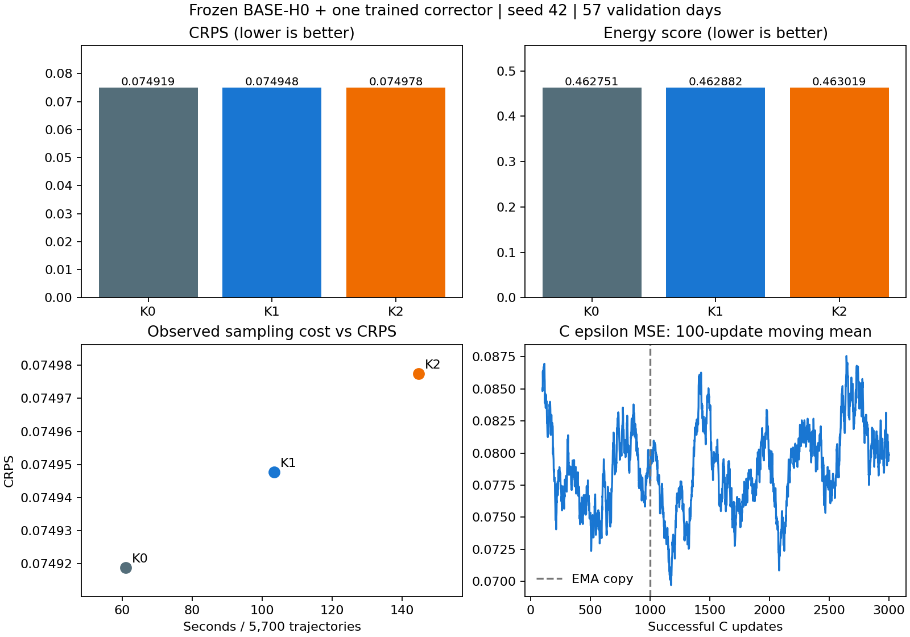

# Prediction-space correction v1

## Frozen question and scope

Reviewed base: `b4ba74c`. Branch: `codex/prediction-correction-v1`.
One new corrector C is trained once, for 3,000 successful updates. The same
C@3000 delayed EMA is evaluated with K=0,1,2. K2 is an inference reuse test;
it is never trained with two corrections. Stop after the fixed table. The
conditional cost-matching experiment requires a separate decision.

Use the existing common history package (545 train / 57 validation days), but
H0 information only: future NWP and calendar. The sealed test split is not
scored. D is the frozen seed-42 BASE-H0 update-3000 **EMA**, with checkpoint SHA256
`60cd2099c864a4946edada2d9f940949d71c3c4311856579632791cdf2422140`.
Original BASE training cost is additional to C's training cost; the old UNTIED
model is not an equal-training-budget comparator for this two-stage system.

[Machine-readable configuration](../configs/prediction_correction_v1.json)
binds data bytes, sample IDs, protocol, scaler, BASE checkpoint and archived
training/source identity, corrector design, RNG seeds and implemented sources.
The inference loader does not restore D's optimizer, clocks or random state.

## Model and numerical contract

C reuses the existing component definitions, with its own 8→64→64 condition
MLP, proposal/condition projection, time MLP, one two-block AdaLN Core, four
attention heads, FFN256 and final output head. Its 24 positions are +1…+24.
Only the final delta head and the usual AdaLN modulators start at zero; there
is no additional multiplicative gate. Initialization seed is 30042.

A proposal is in the diffusion clean-state coordinate **x0=2y−1**. Delta is in
that same coordinate, not capacity-fraction y units. With D frozen:

```
eps0 = D(xt, t, NWP, calendar)
p0 = (xt - sigma[t] * eps0) / a[t]
delta_sum = 0
repeat K times:
    delta_sum += C(p0 + delta_sum, t, NWP, calendar)
eps_corrected = eps0 - (a[t] / sigma[t]) * delta_sum
```

K0 returns eps0 immediately, without any coordinate conversion or C call.
Each C call rebuilds its hidden state from the current proposal. No xt, true
noise, target, or previous hidden state is supplied to C. The noise level,
weather and original xt stay fixed within a call. No internal clamp/tanh is
used. The unchanged DDIM step clips its final clean prediction and recomputes
the consistent noise direction. The schedule already stores square roots.

The sampler wrapper uses a flat prefixed tensor cache; it preserves the same
sample index across D/C conditions. Calling wrapper.train() always leaves D in
eval. K is distinct from the original network's rounds.

## Independent training and recovery

Only C is included in AdamW and gradient clipping: learning rate 1e-4,
matrix-weight decay 1e-4, bias decay zero, betas .9/.999, gradient norm limit 1.
FP32, microbatch 4 × accumulation 8, per-microbatch mean epsilon MSE divided by 8.
Do not substitute unweighted power MSE: it changes the noise-level weighting.
Data-order seed42, training-noise seed43, validation seed2026 are separate.
EMA copies C at update 1000, then lerps with decay .999 from update 1001.

Normal checkpoints are saved every 250 successful updates and at the end. They
contain C raw/EMA, optimizer, data permutation/cursor, CPU/CUDA and noise RNG,
clocks and the complete frozen identity. No D tensors or D optimizer are trained
or averaged. Resume requires matching config, source/data/BASE identity and
device type. `--updates` is additional, and total C updates cannot exceed 3000.
A failure snapshot is marked diagnostic and cannot be resumed. Use the previous
normal checkpoint with a fresh output directory and preserve the segment chain.

## Acceptance and execution

```bash
CUDA_VISIBLE_DEVICES='' python -m unittest discover -s tests -v
python -m unittest tests.test_prediction_correction -v
python -m diagnostics.check_prediction_correction \
  --config configs/prediction_correction_v1.json --device cuda \
  --output outputs/prediction_correction_v1_acceptance_full
python train_correction.py --config configs/prediction_correction_v1.json \
  --device cuda --updates 3000 --output outputs/prediction_correction_v1_s42
python -m diagnostics.evaluate_prediction_correction \
  --config configs/prediction_correction_v1.json \
  --checkpoint outputs/prediction_correction_v1_s42/checkpoint_last.pt \
  --device cuda --mode fixed --output outputs/prediction_correction_v1_s42_fixed
```

Do not rerun into existing directories. Unit tests cover zero correction,
t=1/1000 finite loss/gradients, nonzero upstream learning after several updates,
K2 feedback without internal clipping, flat-cache/direct sampling and reorder,
optimizer ownership, frozen D parameters/buffers, and normal recovery before,
at and after the EMA boundary. Identity checks cover wrong source, data, BASE,
EMA clock, scaler, failure flag and archived JSON/list compatibility.

The real CUDA acceptance uses the full-width C and actual prepared data:
6+2 continuation versus 8 continuous updates, temporary EMA start 3, all model,
EMA, optimizer, RNG and data states compared exactly. Formal EMA start remains
1000. Archive replay uses the original full CUDA noise tensor [57,100,24,1].
The final test also retains the full condition-encoding and chunk16 shapes:
small-panel truncation can change FP32 kernel batching even with full-shape
noise. Failed small-panel attempts are preserved in the acceptance record;
formal training must wait for the complete replay to pass.

## Fixed evaluation and decision

All K settings use the same C checkpoint and explicit initial noise, all 57
validation days,100 scenarios,DDIM50,chunk16. Report CRPS,ES,VS,signed1h/3h
increment CRPS,daily-mean CRPS,90% coverage/width,boundary fraction,latency and
D+C deployment parameter count. Save identified scenarios/targets, per-day
scores and K1−K0,K2−K0,K2−K1 differences. Independently reload and re-score the
saved tensors. K0 must replay the archived BASE scenes on this CUDA environment.

The predeclared development gate requires K2 CRPS and ES below both K0 and K1,
and abs(K2 coverage90−.9) no greater than abs(K0 coverage90−.9). Retain every
structural tradeoff. This is not a significance test. If K1 improves but K2 does
not, evidence supports one correction, not recurrence. If both fail, archive
this prototype. If the gate passes, report that fact but do not automatically
run timing-matched K0/K1. One training seed and repeatedly used validation days
cannot establish generalization.

## Local acceptance results

Python 3.10.20 / PyTorch 2.10.0+cu128, RTX 2060. CPU suite: **149 passed, 8 skipped
(157 total)**. CUDA specialized suite: **7 passed, 0 skipped**. The real full-width
6+2 versus 8 check matches C,EMA,optimizer,CPU/CUDA RNG,training-noise RNG and data
position exactly. Full 57-day K0 replay matches the archived scenes bitwise:
maximum absolute error 0, different values 0. D parameters/buffers remain unchanged.
Syntax checks passed. [Acceptance evidence](experiments/prediction_correction_v1/acceptance/review.json)
includes the two earlier failed small-panel bitwise checks; those were corrected
by preserving full condition-encoder and sampling shapes, not by relaxing the
comparison tolerance. No original model, diffusion or scoring code was modified.

## Completed fixed-endpoint experiment

Implementation freeze `cd814f6`; one C training from scratch completed 3,000 successful updates, zero skipped updates. D remained frozen. EMA copied raw C exactly at 1,000 and averaged 2,000 times. The original test split was not scored. All three settings use this same C@3000 EMA, paired explicit CUDA noise and DDIM50/chunk16 on 57 validation days.

| K | CRPS | ES | VS | 1h increment | 3h increment | Daily mean | 90% coverage | Width | Boundary | Sampling seconds |
|---:|---:|---:|---:|---:|---:|---:|---:|---:|---:|---:|
| 0 | 0.074919 | 0.462751 | 14.516202 | 0.050975 | 0.086097 | 0.036394 | 91.08% | 0.446282 | 4.47% | 60.96 |
| 1 | 0.074948 | 0.462882 | 14.517744 | 0.050976 | 0.086098 | 0.036433 | 91.08% | 0.446275 | 4.46% | 103.50 |
| 2 | 0.074978 | 0.463019 | 14.519594 | 0.050977 | 0.086101 | 0.036472 | 91.08% | 0.446267 | 4.46% | 144.78 |

| Paired comparison | ΔCRPS | ΔES | Days with lower CRPS | Days with lower ES |
|---|---:|---:|---:|---:|
| K1−K0 | +0.000029 | +0.000131 | 24/57 | 25/57 |
| K2−K0 | +0.000059 | +0.000268 | 24/57 | 25/57 |
| K2−K1 | +0.000030 | +0.000137 | 24/57 | 25/57 |

The gate is **not passed**. Its components are:

| Gate requirement | Outcome |
|---|---|
| K2 crps < K0 | False |
| K2 energy_score < K0 | False |
| K2 crps < K1 | False |
| K2 energy_score < K1 | False |
| K2 absolute coverage error ≤ K0 | True |

D has 208,193 parameters; C has 208,065. K1/K2 deployment uses their sum, 416,258; K0 requires only D. C training-update time totals 341.98s, excluding loading/checkpoint IO and prior D training. Sampling time is one observed full-panel run per K, not a repeated latency benchmark. Inference-run allocator peaks include this evaluation runner's resident objects; they are not a minimal deployment-memory estimate.

Independent review reloaded saved scenes, checked identity alignment, re-scored all original and transformed metrics, and matched all per-day tensors exactly. Frozen sources, D/data identities and all 3169 previously protected artifacts remain unchanged. The original full-panel K0 scenes replay bitwise. The review did not retrain a model or score test data.

The complete training record, checkpoint fingerprint, full per-day paired results and identity metadata are archived in [results](experiments/prediction_correction_v1/results/review.json). Large tensors and checkpoints remain local. There is only one trained C; the 57 days are not independent training repeats. No cost-matched sampling or extra training was launched.


### Interpretation and stop decision

This prototype did not improve fixed-endpoint generation. K1 raises mean CRPS
by 0.00002885 relative to K0; K2 raises it a further 0.00002982. K2 versus K0 is
only +0.0783%, so this is a small point-estimate difference, not evidence of
statistically established degradation. ES, VS and the three transformed CRPS
means also move slightly upward; 90% coverage remains exactly the same. The
corrector therefore supplied neither a clear one-step gain nor an incremental
two-step gain in this run.

The cost difference is substantial in these observed runs: K1 takes 1.70× and
K2 takes 2.37× the K0 sampling time. K2 versus K1 takes 1.40×. The unchanged
coverage passes its gate component, but all four CRPS/ES superiority components
fail. Stop and archive the prototype, without additional training, weight
search, seeds or cost-matched evaluations. This result does not isolate whether
the limitation comes from the proposal information, the training objective,
optimization or available residual error; assigning a cause needs a separately
specified experiment.



The cost plot zooms its CRPS axis; refer to the numeric table for the small
absolute differences. The moving training loss is diagnostic and does not
establish improved generated distributions.
