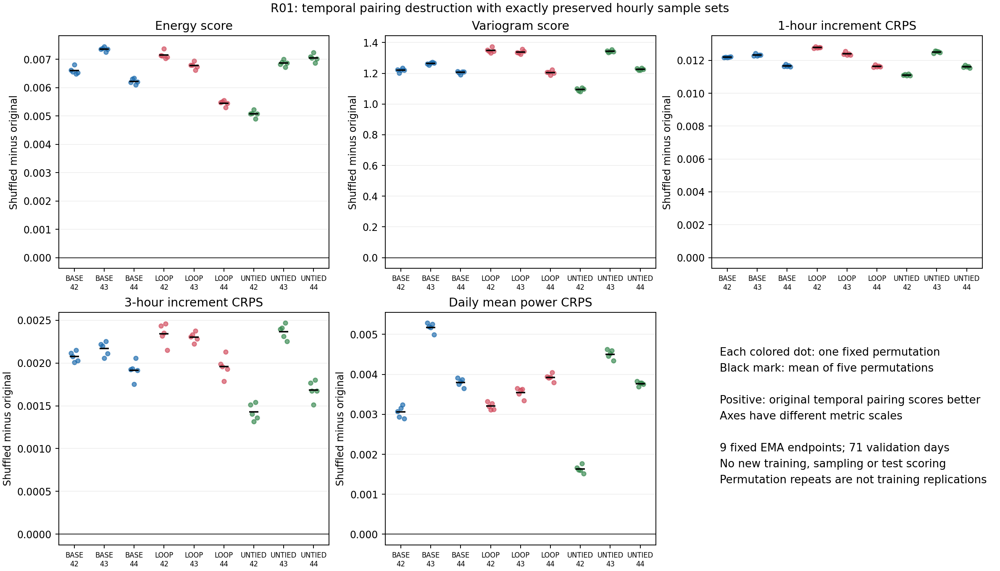

# R01：已保存场景的时间配对诊断

**结果：现有场景的时间配对有实际评分价值，尤其体现在 1 小时增量；这一结果出现在三种架构中，不是 LOOP 特有优势。**九组模型、每组五次打乱后，五个结构指标的全验证集均值全部变差，逐小时边际评分完全不变。

## 冻结问题与输入

本诊断基于 `c3d0ea7` 的九组 v2 固定终点：训练种子 42、43、44，BASE、LOOP、UNTIED，均为第 3,000 步延迟 EMA。每组包含相同的 71 个验证日、100 条场景、24 个小时。只读取已保存场景，不训练、不重新采样、不评价测试集，也不启动 R02–R06。

[固定配置](../configs/diagnostics/temporal_dependence_v1.json) 保存场景/目标/检查点的既有哈希、源文件哈希、样本 ID、维度和评分约定。先按 sample_id、风场、发布及有效时间、单位、数据指纹对齐，再按配置的共同日期顺序应用排列。跨模型的目标值和元信息必须一致。

## 干预与评分

对每个日 d、小时 h，独立抽取成员排列 π：`shuffled[d,m,h] = original[d,π[d,h](m),h]`。不改变小时位置，也不混合日期。固定五个 CPU Generator 种子 **1101、1102、1103、1104、1105**，按共同的日/小时顺序调用 `randperm(100)`；每份索引只生成一次，复用于九组面板。局部 Generator 不推进全局训练 RNG。

原有边际 CRPS、80%/90% 逐点覆盖率与宽度作为不变性检查。结构评分沿用 `metrics.py`：ES 为整条轨迹欧氏距离，不除以 H；VS 使用 p=0.5、全部有序非对角小时对；经验 CRPS 保持 M² 分母。另固定三项变换：

| 诊断 | 场景与目标的相同变换 | 每日评分 |
| --- | --- | --- |
| 1 小时增量 | 第 h+1 小时减第 h 小时，共 23 对 | 逐对计算 CRPS，再取日内均值 |
| 3 小时增量 | 第 h+3 小时减第 h 小时，共 21 对 | 逐对计算 CRPS，再取日内均值 |
| 整日均值 | 对未来 +1,…,+24 小时取算术平均 | 对场景均值分布计算 CRPS |

在 FP64 中做变换及评分。增量为有符号的容量归一化功率差，不裁剪；日均功率单位仍是容量比例，不是 MWh。每个预测日单独评价，不汇集成跨日期的无条件直方图。

定义 `delta = shuffled − original`。对损失型评分，正值表示原时间配对更好；负值照实保留。各指标单位/尺度不同，不比较 ES、VS、增量 CRPS 的绝对差值大小。

## 不变性、身份与只读验收

每次干预要求每个日/小时排序后的成员值逐位相等；边际评分按 `atol=rtol=1e-10` 检查。另对每个日的所有小时使用同一个成员排列：这一负对照只重编号整条轨迹，要求 ES、VS 和三个变换 CRPS 也保持不变。五个共同排列均对九组面板检查。

容差是浮点工程检查，不是显著性阈值。边际 CSV 中可能保留舍入级非零差值，其正负日数没有研究含义。运行前后重新计算受保护文件哈希；变化即报错。检查点仅计算文件哈希，不反序列化、不加载模型。输出必须是新目录，且不能与源运行目录重叠。

## 复现与产物

从仓库根目录，在现有验证环境执行：

```bash
python -m diagnostics.temporal_dependence \
  --config configs/diagnostics/temporal_dependence_v1.json \
  --output outputs/temporal_dependence_v1
python -m unittest discover -s tests -p test_temporal_dependence.py -v
```

- `per_day.csv`：每个训练种子、模型、排列种子、预测日、指标的原值、打乱值和差值。
- `per_permutation.csv`：保留五次打乱各自的全验证集结果，不挑选排列。
- `per_run.csv`：先在每个已训练模型内部汇总五次排列的均值、样本标准差及范围。
- `report.json`：再描述三个训练种子的结果；保留原始/打乱评分、两层波动口径、全部不变性误差、输入哈希、软件版本和变换轴元信息。
- `permutations.pt`、`scores_per_lead.pt`：本地保存实际索引及逐 lead/逐日评分，便于重放。它们不提交 Git。

五次排列只是打乱的 Monte Carlo 波动，不是五次训练；71 日也不是 71 次独立模型实验。跨种子统计先平均每组的五次排列，不将 15 个排列/训练种子组合当作独立训练。原 v2 结果与训练选择规则保持不变。

## 执行状态

协议与实现先冻结于 `6f1bd1e`，在干净工作区完成执行。九组原始面板、45 组逐小时打乱、45 组共同排列对照全部完成，无新增训练或模型采样。全套 CPU 测试 **95 项：93 通过、2 项 CUDA 专用测试跳过**；R01 新增 **13 项**全部通过。环境为 Python 3.10.20、PyTorch 2.10.0+cu128，诊断实际只使用 CPU。


## 结果：原始与打乱后评分

每个模型先对五次排列取均值，再对三个训练种子等权平均。下面的相对变化为“平均差值 / 原始平均分”，不是逐日百分比的平均。所有评分越低越好。

| 指标 | 模型 | 原始 | 打乱后 | Δ | 相对变化 |
| --- | --- | --- | --- | --- | --- |
| ES | BASE-2 | 0.481974 | 0.488701 | +0.006728 | +1.40% |
| ES | LOOP-2×2 | 0.477935 | 0.484393 | +0.006458 | +1.35% |
| ES | UNTIED-4 | 0.476240 | 0.482568 | +0.006329 | +1.33% |
| VS | BASE-2 | 14.784732 | 16.015186 | +1.230454 | +8.32% |
| VS | LOOP-2×2 | 14.608677 | 15.906470 | +1.297792 | +8.88% |
| VS | UNTIED-4 | 14.531945 | 15.753394 | +1.221449 | +8.41% |
| 1h 增量 CRPS | BASE-2 | 0.050915 | 0.062980 | +0.012065 | +23.70% |
| 1h 增量 CRPS | LOOP-2×2 | 0.050697 | 0.062971 | +0.012273 | +24.21% |
| 1h 增量 CRPS | UNTIED-4 | 0.050908 | 0.062658 | +0.011749 | +23.08% |
| 3h 增量 CRPS | BASE-2 | 0.087914 | 0.089966 | +0.002052 | +2.33% |
| 3h 增量 CRPS | LOOP-2×2 | 0.087387 | 0.089588 | +0.002201 | +2.52% |
| 3h 增量 CRPS | UNTIED-4 | 0.087925 | 0.089752 | +0.001826 | +2.08% |
| 日均功率 CRPS | BASE-2 | 0.037564 | 0.041576 | +0.004013 | +10.68% |
| 日均功率 CRPS | LOOP-2×2 | 0.037587 | 0.041148 | +0.003560 | +9.47% |
| 日均功率 CRPS | UNTIED-4 | 0.036859 | 0.040161 | +0.003302 | +8.96% |

**每一项结构指标的 45 个“训练模型 × 排列”全验证集差值均为正**，不是挑选一次排列或一个训练种子的结果。这些 45 个值不是 45 次独立训练，也不是显著性检验。

## 分开报告训练种子与排列波动

下面各格是该训练模型的五次排列差值 **均值 ± 排列样本标准差**（分母 4）；完整五次结果、最小值和最大值分别在 CSV 中保留。这里的标准差仅描述打乱的 Monte Carlo 波动。

| 训练 seed | 模型 | Δ ES | Δ VS | Δ 1h 增量 CRPS | Δ 3h 增量 CRPS | Δ 日均功率 CRPS |
| --- | --- | --- | --- | --- | --- | --- |
| 42 | BASE-2 | 0.006599 ± 0.000130 | 1.220390 ± 0.011350 | 0.012197 ± 0.000015 | 0.002075 ± 0.000059 | 0.003060 ± 0.000144 |
| 42 | LOOP-2×2 | 0.007148 ± 0.000133 | 1.349570 ± 0.015600 | 0.012783 ± 0.000042 | 0.002341 ± 0.000122 | 0.003206 ± 0.000089 |
| 42 | UNTIED-4 | 0.005073 ± 0.000113 | 1.094039 ± 0.010397 | 0.011115 ± 0.000044 | 0.001427 ± 0.000098 | 0.001633 ± 0.000091 |
| 43 | BASE-2 | 0.007361 ± 0.000074 | 1.264699 ± 0.007682 | 0.012329 ± 0.000059 | 0.002167 ± 0.000081 | 0.005177 ± 0.000115 |
| 43 | LOOP-2×2 | 0.006774 ± 0.000117 | 1.338197 ± 0.012515 | 0.012401 ± 0.000094 | 0.002303 ± 0.000057 | 0.003548 ± 0.000127 |
| 43 | UNTIED-4 | 0.006864 ± 0.000108 | 1.343473 ± 0.006729 | 0.012516 ± 0.000066 | 0.002367 ± 0.000084 | 0.004505 ± 0.000114 |
| 44 | BASE-2 | 0.006223 ± 0.000097 | 1.206271 ± 0.009150 | 0.011670 ± 0.000062 | 0.001915 ± 0.000107 | 0.003801 ± 0.000105 |
| 44 | LOOP-2×2 | 0.005453 ± 0.000097 | 1.205610 ± 0.013235 | 0.011637 ± 0.000059 | 0.001959 ± 0.000122 | 0.003926 ± 0.000092 |
| 44 | UNTIED-4 | 0.007049 ± 0.000135 | 1.226835 ± 0.006473 | 0.011617 ± 0.000069 | 0.001685 ± 0.000111 | 0.003769 ± 0.000049 |

再对三个训练种子的排列均值取均值 ± 训练种子样本标准差（分母 2）：

| 模型 | Δ ES | Δ VS | Δ 1h 增量 CRPS | Δ 3h 增量 CRPS | Δ 日均功率 CRPS |
| --- | --- | --- | --- | --- | --- |
| BASE-2 | 0.006728 ± 0.000579 | 1.230454 ± 0.030486 | 0.012065 ± 0.000348 | 0.002052 ± 0.000127 | 0.004013 ± 0.001074 |
| LOOP-2×2 | 0.006458 ± 0.000890 | 1.297792 ± 0.080035 | 0.012273 ± 0.000584 | 0.002201 ± 0.000210 | 0.003560 ± 0.000360 |
| UNTIED-4 | 0.006329 ± 0.001092 | 1.221449 ± 0.124804 | 0.011749 ± 0.000710 | 0.001826 ± 0.000486 | 0.003302 ± 0.001492 |

两种标准差均不是置信区间。共同排列索引用于配对控制，但九个模型共享验证天气数据；不能把这些层次合并成更多独立样本。



彩点保留所有五次排列，黑线为均值；各子图尺度不同，零线表示没有变化。

## 逐日差异不能省略

先在每个预测日平均五次排列差值，再计算正差天数。下表是九个训练模型各自计数的范围，每组分母均为 71：

| 指标 | 原始配对评分更好的天数范围 |
| --- | --- |
| ES | 45–50 / 71 |
| VS | 55–59 / 71 |
| 1h 增量 CRPS | 69–71 / 71 |
| 3h 增量 CRPS | 46–50 / 71 |
| 日均功率 CRPS | 31–42 / 71 |

1h 增量的收益覆盖了绝大多数验证日；日均功率 CRPS 则明显存在日期差异：即使总体均值变差，也不能说打乱对每一天都更差。负差值完整保留，不能从全样本均值推断所有天气状态均有相同收益。

## 工程验收结果

- 45 组独立逐小时排列的日/小时成员集合均精确相等；CRPS、80%/90% 覆盖率及宽度的最大逐项绝对差均为 **0**。
- 45 组共同排列负对照在全部评分上的最大绝对误差为 **7.105427357601002e-15**，小于预先固定的容差。
- 96 个受保护文件的运行前后 SHA-256 完全一致，包含既有场景、目标、检查点、元信息及相关源码。样本身份、时间、单位、数据版本以及跨模型的目标值全部通过核对。
- 原始 CRPS/ES/VS 与 v2 固定终点记录一致。测试还覆盖错误排列、全局 RNG 隔离、错误 split/身份、错误 endpoint、源文件运行前/运行中改变、输出覆盖和路径重叠。
- 诊断过程没有读取原始 CSV 或准备数据包来构造新样本；没有加载模型或反序列化检查点；没有重新采样，也没有测试集评分。

## 可以得到的结论与停止边界

当前证据支持：**这些已训练模型生成的时间配对，确实改善了轨迹及结构评分，且不是小时边际样本集合改变造成的。**因此，不能再把当前结果简单解释成“24 小时任务不需要时间结构”。

但 R01 不回答“必须使用多复杂的时间交互网络”。固定日条件、天气相关的小时边际和时间位置都仍然存在；有限场景的独立排列近似破坏已有依赖，也不是精确枚举完整乘积联合分布。R02 的逐小时条件参照仍有独立的信息价值。

三种架构的打乱损失方向一致，量级接近。**打乱后的下降更大不等于模型更强，更不等于共享循环学到了可复用更新**：原边际分布、原配对质量和指标敏感性都会影响这一差值。原 v2 架构排名及其不稳定性保持原结论。

R01 提供了继续考虑 R02、R03 的依据，但本轮到此停止，未实现对角注意力、状态干预、中间监督、历史分支或更深循环。71 个完整验证日上的开发证据仍不能替代独立时段或封存测试集验证；既有数据来源与 NWP 可用时间的限制未改变。

## 已提交与本地产物

- [完整报告 JSON 与全部控制误差](diagnostics/temporal_dependence_v1/report.json)
- [每个排列的全部结果：450 行](diagnostics/temporal_dependence_v1/per_permutation.csv)
- [逐日原值/打乱值/差值：31,950 行](diagnostics/temporal_dependence_v1/per_day.csv)
- [每个训练模型的排列汇总：90 行](diagnostics/temporal_dependence_v1/per_run.csv)
- [逐日差值方向计数](diagnostics/temporal_dependence_v1/daily_direction_counts.json)
- [验收摘要](diagnostics/temporal_dependence_v1/verification.json)、[测试日志](diagnostics/temporal_dependence_v1/tests_cpu.log)、[执行日志](diagnostics/temporal_dependence_v1/execution.log)、[产物哈希](diagnostics/temporal_dependence_v1/artifact_sha256.json)

`outputs/temporal_dependence_v1/` 保留实际排列索引与逐 lead 评分张量，不提交大张量。图形可从归档 CSV 重建：

```bash
python docs/diagnostics/temporal_dependence_v1/plot_results.py \
  --results docs/diagnostics/temporal_dependence_v1 \
  --output outputs/temporal_dependence_v1_plot.png
```

重跑诊断时选择新的输出目录；历史 v2 结果、旧诊断输出和输入文件均不覆盖。
